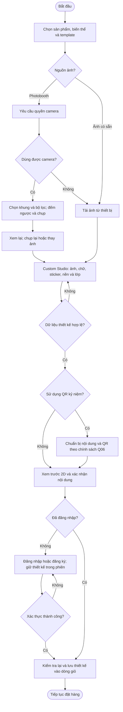
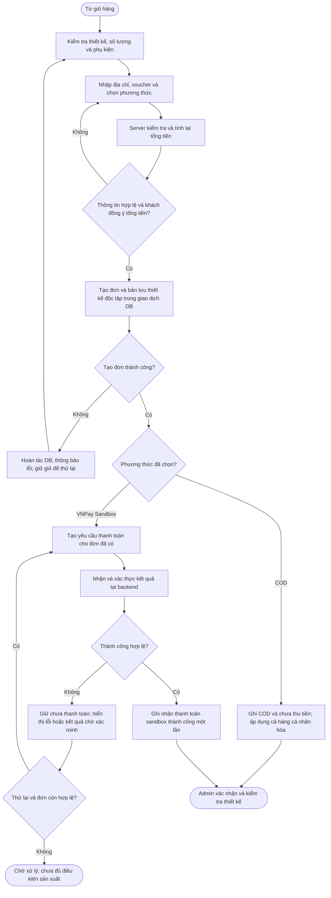
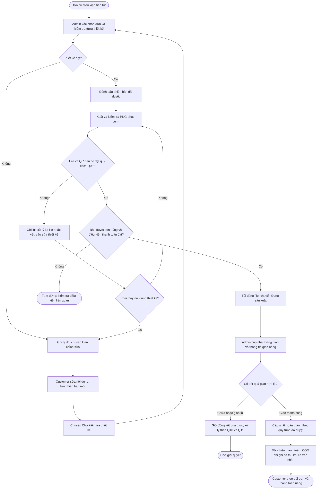

# Quy trình nghiệp vụ chính BW-01 Memoria Lab

## 1. Mục tiêu và phạm vi

BW-01 mô tả quy trình tạo và đặt mua quà tặng kỷ niệm cá nhân hóa trên **Memoria Lab**, từ chọn sản phẩm, chụp Photobooth hoặc tải ảnh, thiết kế trong Custom Studio, chuẩn bị nội dung kỷ niệm và QR, đến giỏ hàng, đặt hàng, thanh toán, Admin duyệt thiết kế, chuẩn bị in và theo dõi giao hàng.

### 1.1. Tình huống minh họa

Khách chọn Photostrip, khung tranh để bàn hoặc thiệp, lựa chọn kích thước/chất liệu và template tương thích. Khách có thể dùng webcam để chụp theo khung hoặc tải ảnh từ thiết bị; sau đó kéo thả ảnh, chỉnh chữ, thêm sticker, thay nền và sắp xếp lớp trong vùng thiết kế được phép. Khách xem trước 2D, chuẩn bị trang kỷ niệm và QR nếu sử dụng, đăng nhập để lưu giỏ, rồi đặt hàng bằng **VNPay Sandbox hoặc COD**.

Admin kiểm tra thiết kế, yêu cầu khách sửa khi cần, duyệt đúng phiên bản và tải file phục vụ in. Đơn COD, kể cả hàng cá nhân hóa, được tiếp tục duyệt và sản xuất khi hợp lệ dù chưa thu tiền. Đơn chọn VNPay chỉ được sản xuất sau khi có kết quả thanh toán sandbox thành công đã được backend xác thực.

### 1.2. Giới hạn

- Sản phẩm cá nhân hóa là ấn phẩm phẳng một mặt; các khổ theo brainstorm gồm 5 × 15 cm, 10 × 15 cm và A5, phải tương thích từng sản phẩm/template.  
- Studio có thao tác kéo thả, đổi kích thước, xoay/lật, sticker, văn bản và thứ tự lớp; không còn giới hạn toàn bộ thiết kế vào ô ảnh/ô chữ cố định như bản workflow cũ. Khung chuẩn và ranh giới thiết kế vẫn được bảo vệ.  
- Chỉ xem trước 2D hoặc phối cảnh phẳng; không bổ sung 3D, NFC, thiết kế bằng AI hay tự động điều khiển máy in.  
- QR trên quà tặng liên kết nội dung kỷ niệm, khác với mã phục vụ thanh toán. Thời điểm kích hoạt, quyền xem và thời hạn giữ nội dung QR chưa được chốt.  
- Video quá trình chụp và link tải tạm là các đề xuất chưa được xác nhận, không phải bước bắt buộc của BW-01.  
- Chưa chốt quy tắc phí ship, voucher, hủy/hoàn, file in và lưu dữ liệu; workflow chỉ nêu điểm áp dụng, không tự đặt chính sách thay nhóm.  
- Sản phẩm bán sẵn có thể bỏ qua Photobooth, Studio, QR và duyệt thiết kế. Quy trình chính dưới đây tập trung vào hàng cá nhân hóa; xử lý giao chung/tách đợt của đơn hỗn hợp còn thuộc Q11.

## 2. Tác nhân, điều kiện và kết quả

### 2.1. Tác nhân

| Tác nhân | Vai trò trong BW-01 |  
|---|---|  
| Guest | Xem/tìm/lọc sản phẩm, thử Photobooth và Custom Studio trong phiên. Đăng nhập/đăng ký trước khi lưu thiết kế vào giỏ hoặc đặt hàng. |  
| Customer | Quản lý thiết kế và giỏ của mình; nhập thông tin nhận hàng; chọn VNPay Sandbox hoặc COD; xem đơn và gửi bản sửa khi Admin yêu cầu. |  
| Hệ thống Memoria Lab | Kiểm tra dữ liệu/file/quyền; xử lý preview, lưu cấu hình và QR; tính lại tiền tại server; tạo đơn cùng bản lưu thiết kế độc lập; xác thực payment; quản lý phiên bản và trạng thái. |  
| VNPay Sandbox | Nhận yêu cầu thanh toán thử và trả kết quả để backend xác thực; không phải bằng chứng chuyển tiền thật. |  
| Admin | Quản lý dữ liệu cửa hàng; xác nhận đơn, duyệt/yêu cầu sửa thiết kế có lý do; kiểm tra và tải file in; cập nhật xử lý/giao hàng và kết quả thu COD theo quy trình được duyệt. Không tự sửa thiết kế thay khách. |  
| Dịch vụ hoặc đơn vị vận chuyển | Cung cấp thông tin phí/giao hàng/thu COD nếu phương án tích hợp hoặc vận hành được chọn. Chưa mặc định đã tích hợp API; xem Q10. |  
| Người xem kỷ niệm | Quét QR để xem nội dung được phép chia sẻ. Đây là ngữ cảnh truy cập, không tự tạo quyền xem ảnh nguồn riêng tư, thiết kế chỉnh sửa hoặc dữ liệu đơn. |

### 2.2. Điều kiện bắt đầu

- Website có sản phẩm, biến thể, template, khung và tài nguyên được phép sử dụng.  
- Sản phẩm được chọn đang cho phép đặt mua và có quy cách tương thích thiết kế.  
- Với nhánh webcam, thiết bị/trình duyệt hỗ trợ và người dùng đồng ý cấp quyền camera. Không cấp quyền vẫn có thể đi theo nhánh tải ảnh.  
- Các cấu hình chưa chốt phải được xác nhận trước khi dùng để nghiệm thu nghiệp vụ tương ứng; không coi cấu hình thử là chính sách đã duyệt.

### 2.3. Điều kiện trước khi đặt hàng

- Customer đã đăng nhập; backend xác minh chủ sở hữu giỏ và thiết kế.  
- Mỗi dòng hàng có sản phẩm/biến thể, số lượng và phụ kiện hợp lệ. Hàng cá nhân hóa có cấu hình thiết kế và preview gắn đúng dòng; dữ liệu hợp lệ theo cấu hình đã được duyệt.  
- Địa chỉ, voucher nếu có, phí giao hàng và tổng tiền được server kiểm tra lại; khách xác nhận các thay đổi trước khi tạo đơn.  
- Khách lựa chọn một phương thức: VNPay Sandbox hoặc COD. **COD áp dụng cho cả hàng bán sẵn và hàng cá nhân hóa**, không còn là quyết định đang chờ xác nhận.

### 2.4. Kết quả mong đợi

- Đơn, các dòng đơn, thông tin giá và bản lưu thiết kế độc lập được tạo nhất quán; không còn đơn dở sau lỗi tạo đơn.  
- Mỗi sản phẩm được gắn đúng thiết kế, QR/nội dung liên quan nếu có, và phiên bản phục vụ duyệt/in.  
- Trạng thái xử lý, thanh toán và kết quả từng lần giao dịch được phân biệt.  
- Admin không đưa thiết kế chưa duyệt hoặc file in chưa đạt vào sản xuất; Customer chỉ sửa nội dung khi được phép.  
- Customer theo dõi đơn của mình; nội dung kỷ niệm chỉ được hiển thị theo chính sách chia sẻ và kích hoạt được xác nhận.

## 3. Sơ đồ quy trình nghiệp vụ

Ba sơ đồ sau là các đoạn nối tiếp của BW-01: chuẩn bị thiết kế → đặt hàng/thanh toán → duyệt/in/giao hàng. Nội dung QR có điều kiện theo lựa chọn sản phẩm và Q06; video/link tải tạm chưa được đưa thành bước bắt buộc.

### 3.1. Chọn sản phẩm và tạo thiết kế

Lỗi file, chữ hoặc tài nguyên được kiểm tra khi nhập và khi lưu. Vùng thiết kế/khung khóa được bảo vệ; việc kéo thả không đồng nghĩa được thay đổi kích thước chuẩn của nhà in. QR có thể được chuẩn bị trong phiên; thời điểm cấp liên kết bền vững và kích hoạt trang vẫn theo Q06.

### 3.2. Đặt hàng và thanh toán

Thử thanh toán lại sử dụng đơn còn hợp lệ, không quay lại tạo một đơn mới chỉ vì callback lỗi. Callback lặp phải được xử lý mà không ghi nhận thanh toán nhiều lần. Không xác định thanh toán thành công chỉ từ trang trình duyệt trả về. Nhánh yêu cầu hủy/đổi phương thức tuân theo Q11 sau khi được chốt.

### 3.3. Duyệt thiết kế, chuẩn bị in và giao hàng

Điều kiện thanh toán tại nút kiểm tra gồm một trong hai trường hợp: **VNPay Sandbox đã thành công và được xác thực**, hoặc **đơn COD hợp lệ dù chưa thu tiền**. Cả hai vẫn phải có thiết kế được duyệt và file in đạt yêu cầu. Giao thành công không tự động chứng minh đã thu COD; quy trình ghi nhận thu, hoàn tất đơn và xử lý giao lỗi còn theo Q10/Q11.

Các nút “chờ” là điểm dừng của lần xử lý hiện tại, không phải tuyên bố đơn đã hoàn tất hay tự bị hủy. Sơ đồ không chốt chính sách hủy, hoàn tiền hoặc thời hạn chờ khách.

## 4. Diễn giải từng bước: thao tác – phản hồi – dữ liệu

“Dữ liệu phiên” là nội dung khách đang thao tác, chưa đồng nghĩa đã lưu vào tài khoản/giỏ hoặc đã công khai. “Dữ liệu lưu” là dữ liệu được hệ thống ghi nhận khi bước hợp lệ. Bản lưu thiết kế của đơn phải độc lập với bản trong giỏ; thay đổi sau đó cần có phiên bản và đúng quyền.

| Bước | Tác nhân / thao tác | Phản hồi hệ thống | Dữ liệu sử dụng / lưu |  
|---|---|---|---|  
| 1 | Guest/Customer tìm, lọc và mở sản phẩm. | Hiển thị danh mục, thông tin, giá, đánh giá và các lựa chọn được phép. | Đọc dữ liệu sản phẩm; chưa tạo đơn. |  
| 2 | Chọn khổ, chất liệu, phụ kiện và template. | Hiển thị giá dự kiến; kiểm tra tương thích sản phẩm/biến thể/template; thể hiện vùng thiết kế và khung khóa. | Lựa chọn biến thể, khổ, template và phụ kiện trong phiên. |  
| 3 | Chọn chụp Photobooth hoặc tải ảnh. | Nhánh webcam yêu cầu quyền; nếu không dùng được camera có đường tải ảnh. Chọn khung 1×3, 1×4 hoặc 2×2 tương thích, bộ lọc và đếm ngược. | Quyền camera do trình duyệt quản lý; trạng thái phiên chụp, khung và bộ lọc. Không tự ghi video. |  
| 4 | Chụp, xem lại, chụp lại hoặc thay ảnh từ thiết bị. | Chụp đủ số ô; hiệu ứng màu có trong ảnh kết quả; kiểm tra định dạng JPEG/PNG/WebP, dung lượng/kích thước theo Q04; dừng camera khi kết thúc sử dụng. | Ảnh trong phiên và thứ tự ô; không tự coi ảnh đã được công khai hoặc lưu lâu dài. |  
| 5 | Thiết kế trong Custom Studio. | Cho kéo thả, đổi kích thước, xoay/lật, thêm chữ/sticker, chỉnh nền và thứ tự lớp; bảo vệ phần khóa; kiểm tra đầu vào; cập nhật preview 2D. | Cấu hình đối tượng, vị trí/kích thước, font/màu, lớp, template và tài nguyên trong phiên. |  
| 6 | Chuẩn bị nội dung kỷ niệm và QR nếu sử dụng. | Gắn ảnh/lời nhắn/nhạc với nội dung tương ứng; chuẩn bị QR trỏ đúng trang. Quyền xem và kích hoạt theo Q06; không mặc định có QR là trang đã công khai. | Nội dung kỷ niệm, định danh/liên kết QR và cấu hình chia sẻ khi được chốt; phân biệt ảnh được chia sẻ với ảnh nguồn riêng tư. |  
| 7 | Kiểm tra preview, điều chỉnh và chọn lưu vào giỏ. | Kiểm tra thiết kế; yêu cầu đăng nhập nếu là Guest; giữ nội dung đang làm trong phiên hợp lệ; không thêm giỏ khi xác thực lỗi. | Cấu hình và preview chuẩn bị lưu; liên kết với Customer sau khi đăng nhập hợp lệ. |  
| 8 | Customer thêm vào giỏ và kiểm tra lại. | Tạo từng dòng giỏ riêng cho thiết kế khác nhau; cho sửa thiết kế, đổi số lượng/xóa; hiển thị phụ kiện gợi ý nhưng không tự thêm. | Customer, sản phẩm/biến thể, cấu hình thiết kế, template/tài nguyên, preview, nội dung/QR nếu có, số lượng; giữ giỏ khi tải lại. |  
| 9 | Nhập địa chỉ, voucher và phương thức VNPay Sandbox hoặc COD. | Kiểm tra thông tin; server tính lại giá, mức giảm và phí; có chênh lệch phải để khách kiểm tra/xác nhận. Không chặn COD chỉ vì hàng cá nhân hóa. | Địa chỉ nhận, kết quả voucher, phí/tổng dự kiến, phương thức. Chính sách tính theo Q09/Q10. |  
| 10 | Xác nhận đặt hàng. | Tạo đơn, các dòng và bản lưu thiết kế độc lập trong cùng giao dịch DB; lỗi thì hoàn tác phần DB liên quan. Lưu QR/nội dung đúng sản phẩm, không dùng nhầm bản có thể bị sửa từ giỏ. | Mã đơn, dòng đơn, giá/giảm/phí tại lúc đặt, địa chỉ, phương thức, bản thiết kế độc lập, tham chiếu phiên bản, trạng thái ban đầu. |  
| 11 | Thanh toán VNPay Sandbox hoặc tiếp tục đơn COD. | VNPay: tạo request cho đơn, xác thực kết quả tại backend, đối chiếu mã/số tiền và ghi nhận một lần. Thất bại/hủy chưa thành công; cho thử lại khi hợp lệ. COD: lưu chưa thu tiền và chuyển tiếp theo quy trình duyệt. | Phương thức, trạng thái thanh toán, thông tin từng lần giao dịch và kết quả xác minh; tách khỏi trạng thái đơn. |  
| 12 | Hệ thống thông báo kết quả tạo đơn; Customer theo dõi. | Hiển thị đơn trong tài khoản; gửi email xác nhận theo FR-ORD-07. Email lỗi được ghi nhận/gửi lại, không rollback một đơn đã tạo thành công chỉ vì email chưa gửi. | Đơn và trạng thái thông báo; nội dung email chỉ chứa dữ liệu/đường dẫn được phép. |  
| 13 | Admin xác nhận đơn và kiểm tra thiết kế. | Với đơn đủ điều kiện, duyệt bản hợp lệ hoặc ghi lý do yêu cầu sửa; không sản xuất bản chưa duyệt; không sửa thiết kế thay khách. | Trạng thái kiểm tra, lý do, người/thời điểm xử lý và phiên bản được xem/duyệt. |  
| 14 | Customer sửa khi nhận yêu cầu và gửi lại. | Chỉ chủ sở hữu và đúng trạng thái mới được sửa; không đổi biến thể/số lượng/giá; lưu phiên bản mới và chuyển Chờ kiểm tra thiết kế. | Nội dung sửa, phiên bản mới và lịch sử; giữ bản cũ để truy vết. |  
| 15 | Admin kiểm tra lại và xác nhận bản thiết kế. | Bản sửa phải được duyệt lại; tải/xuất theo đúng phiên bản đã được duyệt; không trộn bản mới chưa duyệt với quyết định duyệt cũ. | Định danh phiên bản duyệt và trạng thái từng thiết kế/dòng đơn liên quan. |  
| 16 | Chuẩn bị và kiểm tra file in. | Kết xuất PNG đúng khổ và Q08; giữ ảnh/chữ/sticker/nền/QR; kiểm tra font, bố cục, chất lượng và khả năng quét QR. Lỗi không được báo file đạt. | File in và thông tin kiểm tra gắn phiên bản duyệt; preview/mockup và ảnh in được phân biệt. |  
| 17 | Admin tải file và chuyển Đang sản xuất. | Kiểm tra lại bản duyệt, file đạt và điều kiện phương thức: VNPay thành công đã xác thực hoặc COD hợp lệ chưa thu. | File được tải, trạng thái xử lý và lịch sử; không tự đổi COD thành đã thu. |  
| 18 | Admin cập nhật Đang giao và kết quả giao. | Hiển thị thông tin giao/mã vận đơn nếu có; ghi đúng kết quả; ghi nhận hoàn thành và thu COD theo quy trình Q10/Q11 được chốt. | Thông tin vận chuyển, kết quả giao, trạng thái đơn và xác nhận thanh toán riêng. |  
| 19 | Customer theo dõi; người nhận xem trang kỷ niệm. | Customer chỉ xem đơn của mình; trang QR chỉ mở khi đáp ứng cơ chế kích hoạt/quyền tại Q06 và còn hiệu lực theo Q07. Không bắt buộc trang chỉ mở sau hoàn thành nếu chưa có quyết định đó. | Dữ liệu đơn theo quyền; nội dung được phép chia sẻ của đúng trang kỷ niệm. |

### 4.1. Điều kiện chuyển tiếp và quản lý trạng thái

| Nhóm | Quy tắc đã có căn cứ |  
|---|---|  
| Khởi tạo | Đơn được tạo và hiển thị Chờ xác nhận theo bản REQUIREMENTS. Kết quả payment và điều kiện tiếp tục được kiểm tra riêng. |  
| Chưa thanh toán VNPay | Chưa đủ điều kiện sản xuất. Hiển thị nhu cầu thanh toán/thử lại nhưng không tự coi thất bại một lần là hủy toàn bộ đơn. |  
| Đơn COD | Được xác nhận, kiểm tra và sản xuất khi hợp lệ; không bắt buộc thu trước, kể cả hàng cá nhân hóa. |  
| Duyệt thiết kế | Chờ kiểm tra thiết kế → Đã duyệt, hoặc Chờ kiểm tra thiết kế → Cần chỉnh sửa → khách gửi bản mới → Chờ kiểm tra thiết kế. |  
| Chuẩn bị sản xuất | Chỉ phiên bản duyệt còn hiệu lực, file in đạt và phương thức hợp lệ mới chuyển Đang sản xuất. |  
| Giao hàng | Đang sản xuất → Đang giao → Hoàn thành khi đáp ứng quy trình đã được chốt. Giao lỗi/hoàn hàng không được tự ghi Hoàn thành. |  
| Thanh toán | VNPay ghi nhận kết quả sandbox đã xác thực; COD chỉ ghi đã thu khi có căn cứ xác nhận. Tên hiển thị có thể là Chưa thanh toán/Đã thanh toán nhưng phải ghi rõ nguồn và môi trường. |  
| Hủy/hoàn tiền | Thực hiện sau khi Q11 xác nhận điều kiện, mốc hủy và cách xử lý. Không mặc định chỉ hủy trước duyệt; không tự ghi hoàn tiền thủ công đã hoàn tất khi chưa có căn cứ. |

Bảng này nêu các mốc và ràng buộc đã có, chưa thay thế một bảng trạng thái đầy đủ cho mọi ngoại lệ. Cách chuyển trạng thái từng dòng trong đơn hỗn hợp, giao nhiều đợt, đổi phương thức, hết hạn đơn hoặc chờ bản sửa còn cần chốt Q10/Q11.

## 5. Các trường hợp ngoại lệ quan trọng

Các mã E01–E09 được giữ để dễ cập nhật tài liệu cũ; E08/E09 được sửa để không còn áp chính sách hủy/COD chưa được duyệt. Bổ sung các ngoại lệ Photobooth, QR, file in và phiên bản. Mã ngoại lệ trong file này độc lập với cách đánh số ngoại lệ tóm tắt ở REQUIREMENTS; bảng đối chiếu dùng mã FR/NFR làm căn cứ.

| Mã | Tình huống | Cách xử lý / phản hồi |  
|---|---|---|  
| E01 | Guest bấm lưu giỏ/đặt hàng hoặc hết phiên xác thực. | Yêu cầu đăng nhập/đăng ký; giữ thiết kế đang làm theo chính sách phiên Q07; kiểm tra lại dữ liệu/quyền trước lưu. Không tạo đơn cho tài khoản chưa xác thực hoặc chuyển thiết kế sang sai tài khoản. |  
| E02 | Ảnh sai định dạng/giả file ảnh/quá dung lượng hoặc kích thước; chữ vượt giới hạn; tài nguyên không hợp lệ. | Thông báo cụ thể; yêu cầu sửa/chọn lại; không chấp nhận bản thiết kế chưa hợp lệ. Kiểm tra cả ở backend khi lưu; ngưỡng thuộc Q04. |  
| E03 | Địa chỉ thiếu, voucher không tồn tại/hết hạn/sai điều kiện hoặc giá client bị sửa. | Server kiểm tra lại giá/voucher/phí; hiển thị lỗi và chênh lệch để khách xác nhận. Không tạo đơn khi thiếu dữ liệu bắt buộc hoặc chưa xác nhận số tiền mới. |  
| E04 | Lỗi tạo đơn, dòng đơn hoặc bản lưu thiết kế. | Hoàn tác giao dịch DB; không xác nhận đơn dở; giữ khả năng thử lại. File đã tải lên được đánh dấu/dọn theo Q07; rollback DB không tự xóa file ngoài CSDL. |  
| E05 | VNPay thất bại/hủy/sai chữ ký/sai số tiền; callback lặp hoặc chưa có kết quả đáng tin cậy. | Không ghi thanh toán thành công sai/trùng; lưu từng lần giao dịch; không cho sản xuất đơn VNPay chưa thành công hợp lệ. Cho thử lại trên đơn còn hợp lệ; không tạo lại đơn chỉ vì trả kết quả lỗi. |  
| E06 | Admin phát hiện thiết kế không đạt. | Bắt buộc lý do; chuyển Cần chỉnh sửa. Khách chỉ sửa nội dung đúng quyền, không đổi biến thể/số lượng/giá; lưu bản mới rồi Admin duyệt lại. |  
| E07 | Truy cập đơn, ảnh nguồn, thiết kế hoặc file in không có quyền. | Backend từ chối và không tiết lộ đường dẫn riêng. Quyền xem nội dung chia sẻ qua QR không cấp quyền xem dữ liệu nguồn/đơn. |  
| E08 | Khách yêu cầu hủy, đổi, hoàn hoặc callback thành công đến sau yêu cầu hủy. | Kiểm tra chính sách Q11 sau khi được duyệt; lưu kết quả giao dịch để đối soát; không tự hồi sinh đơn đã hủy, ghi hoàn tất hoàn tiền hay giả định mốc hủy trước duyệt. Tách nghiệp vụ thử nghiệm khỏi tiền thật. |  
| E09 | Khách chọn COD cho hàng cá nhân hóa hoặc đơn hỗn hợp. | Đây là lựa chọn hợp lệ theo xác nhận của nhóm, không phải lỗi để từ chối. Chỉ xử lý các lỗi độc lập như địa chỉ/giỏ/thiết kế sai. COD chưa thu tiền vẫn tiếp tục duyệt và sản xuất khi đạt điều kiện khác. |  
| E10 | Từ chối quyền camera, không có camera hoặc camera ngắt giữa chừng. | Báo trạng thái thực; cho tải ảnh/thử lại; giữ ảnh đã chụp phù hợp trong phiên; không báo đã hoàn tất khi thiếu ảnh; dừng camera khi kết thúc sử dụng. |  
| E11 | Xuất file lỗi, font/ảnh/sticker chưa tải, QR bị che hoặc không đọc được. | Không cho đưa file lỗi vào in. Xử lý xuất lại nếu nội dung không thay đổi; nếu cần sửa nội dung thì tạo bản mới và duyệt lại, không dùng quyết định duyệt cũ cho bản đã thay. |  
| E12 | QR sai liên kết, chưa kích hoạt, bị tắt hoặc hết hạn. | Hiển thị trạng thái phù hợp theo Q06/Q07; không lộ thông tin đơn. Nếu QR/file in đang chuẩn bị không đúng trang, yêu cầu xử lý trước sản xuất. |  
| E13 | Sửa giỏ/template/tài nguyên sau khi đơn đã tạo; có nhiều phiên bản thiết kế. | Đơn giữ bản lưu độc lập và tài nguyên/phiên bản truy vết được. Chỉ bản được duyệt mới dùng cho in; thay giỏ không tự sửa nội dung QR của đơn đã xác nhận. |  
| E14 | Gửi email xác nhận hoặc email sự kiện lỗi. | Ghi lỗi để gửi lại; thông tin đơn và yêu cầu sửa vẫn có trong tài khoản. Không tạo thêm đơn hoặc lặp chuyển trạng thái khi gửi lại email; email sự kiện bổ sung theo Q13. |  
| E15 | Giao thất bại, chưa có xác nhận thu COD hoặc số tiền thu không khớp. | Ghi nhận đúng tình trạng, chưa ghi đã thu/hoàn tất đối soát; xử lý theo Q10/Q11, không tự tạo chính sách giao lại/hoàn hàng. |  
| E16 | Khách không phản hồi yêu cầu sửa, muốn đổi quy cách/giá hoặc đổi phương thức sau đặt. | Không cho sửa trường ngoài phạm vi FR-STU-09. Thời hạn, cách nhắc và quy trình thay đổi theo Q11/Q13; chưa tự đặt thời gian tự hủy. |

## 6. Đối chiếu với REQUIREMENTS

### 6.1. Truy vết quy trình

Các mã dưới đây khớp bản REQUIREMENTS Memoria Lab đã viết lại theo brainstorm. Khoảng mã chỉ liệt kê khi các mã tương ứng có thực; không suy ra chức năng không có trong tài liệu.

| Giai đoạn | Mã yêu cầu liên quan | Nội dung phù hợp |  
|---|---|---|  
| Tìm/chọn sản phẩm | FR-PRD-01, FR-PRD-02, FR-PRD-04, FR-PRD-06 | Tìm/lọc/sắp xếp, xem chi tiết, chọn biến thể/template tương thích và giá dự kiến. |  
| Photobooth/tải ảnh | FR-PHO-01, FR-PHO-02, FR-PHO-03, FR-PHO-04, FR-PHO-05, FR-PHO-06; FR-STU-02; NFR-SEC-11 | Quyền camera, khung/bộ lọc/đếm ngược/chụp lại, tải dự phòng và chuyển ảnh; không ghi video ngầm. |  
| Custom Studio | FR-STU-01, FR-STU-03, FR-STU-04, FR-STU-05, FR-STU-06, FR-STU-07; FR-UX-01 | Kéo thả/biến đổi ảnh/chữ/sticker/lớp, nền/khung khóa, preview 2D. |  
| Kỷ niệm và QR | FR-MEM-01, FR-MEM-02, FR-MEM-03, FR-MEM-04; NFR-SEC-10 | Nội dung đúng sản phẩm, QR riêng, quyền xem/kích hoạt theo Q06 và thời hạn theo Q07. |  
| Đăng nhập/lưu giỏ | FR-AUTH-01; FR-STU-08, FR-STU-11; FR-CART-01, FR-CART-03, FR-CART-05; NFR-DATA-01 | Giữ thiết kế khi đăng nhập; dòng giỏ riêng; cấu hình/preview đúng tài khoản; gợi ý không tự thêm. |  
| Checkout/tạo đơn | FR-ORD-01, FR-ORD-02; FR-VCH-01; FR-SHP-01; NFR-REL-01, NFR-REL-02 | Server tính lại tiền, kiểm tra địa chỉ/voucher; tạo dữ liệu nhất quán và snapshot độc lập. |  
| VNPay/COD | FR-PAY-01, FR-PAY-02, FR-PAY-03 | VNPay Sandbox xác thực thành công/thất bại/hủy và chống lặp; COD dùng được cho hàng cá nhân hóa, chưa thu vẫn tiếp tục hợp lệ. |  
| Thông báo/theo dõi | FR-ORD-05, FR-ORD-07, FR-ORD-08; FR-CUS-02 | Trạng thái đơn/payment riêng; email xác nhận; yêu cầu sửa thấy trong tài khoản; email bổ sung còn theo ưu tiên/điều kiện. |  
| Duyệt/sửa/in | FR-STU-09, FR-STU-10; FR-ADM-05, FR-ADM-06, FR-ADM-09; NFR-DATA-01 | Sửa có phiên bản và duyệt lại; kiểm tra file trước in; dùng đúng bản được duyệt. |  
| Vận chuyển/thu COD | FR-SHP-01; FR-PAY-01; FR-ORD-05; FR-ADM-06 | Theo dõi giao riêng với thu tiền; không mặc định đã tích hợp API hoặc đã thu COD. FR-SHP-02 chỉ triển khai theo Q10 sau khi được chốt. |  
| Hủy/bảo mật/file tạm | FR-ORD-06; NFR-SEC-01, NFR-SEC-02, NFR-SEC-07, NFR-SEC-08, NFR-SEC-10; NFR-DATA-02 | Quyền sở hữu, kiểm tra dữ liệu, bảo vệ secret, ảnh riêng, vòng đời file; hủy/hoàn chưa tự chốt chính sách. |

FR-PHO-07 và FR-MEM-05 vẫn là đề xuất chờ xác nhận, không trở thành yêu cầu bắt buộc chỉ vì xuất hiện trong tài liệu liên quan. BW-01 không mô tả mọi nghiệp vụ quản trị, Dashboard hoặc review của hệ thống; các chức năng ngoài hành trình chính vẫn được giữ trong REQUIREMENTS và kế hoạch kiểm thử.

### 6.2. Kiểm tra tính nhất quán trước khi nghiệm thu quy trình

- Có thể hoàn thành nhánh chụp camera và nhánh tải ảnh mà không mất dữ liệu khi chuyển Studio/đăng nhập.  
- Thiết kế khác nhau giữ dòng giỏ riêng; sửa giỏ không đổi bản lưu của đơn cũ.  
- QR nếu có gắn đúng sản phẩm và chỉ hiển thị nội dung được phép theo chính sách đã chốt.  
- VNPay thành công hợp lệ, thất bại, hủy, callback sai/lặp được xử lý riêng; không đi từ thất bại thẳng sang sản xuất.  
- Đơn cá nhân hóa COD đi qua duyệt/in khi hợp lệ dù chưa thu tiền; không giả thanh toán trước để vượt kiểm tra.  
- Admin yêu cầu sửa có lý do; khách sửa đúng quyền; phiên bản mới được duyệt lại; file in đúng phiên bản.  
- File in đạt quy cách Q08; preview/mockup không bị dùng nhầm thành file in; QR trong file nếu có đọc được.  
- Trạng thái giao, hoàn thành và thu tiền được kiểm tra riêng; hủy/hoàn và giao lỗi theo chính sách đã duyệt.  
- Mỗi kết quả kiểm tra có dữ liệu, kỳ vọng, thực tế và bằng chứng; chưa có kết quả chạy thì chỉ ghi là kế hoạch kiểm tra.

### 6.3. Các quyết định còn cần nhóm chốt

| Quyết định trong REQUIREMENTS | Nội dung ảnh hưởng BW-01 |  
|---|---|  
| Q03 | Bộ sản phẩm/biến thể/template/khung/sticker/bộ lọc và dữ liệu demo. |  
| Q04 | Dung lượng/pixel/số lượng ảnh, giới hạn chữ/đối tượng, vùng thiết kế và crop. |  
| Q05 | Có video quá trình chụp và link tải tạm hay không; định dạng/thời lượng. Không tự đưa vào nhánh bắt buộc. |  
| Q06 | Quyền xem, lúc tạo liên kết/kích hoạt, quyền sửa/tắt và vòng đời phiên bản nội dung QR. |  
| Q07 | Thời hạn phiên/file tạm/ảnh giỏ/ảnh đơn/trang kỷ niệm; xử lý file mồ côi; giữ link phục vụ đánh giá. |  
| Q08 | Quy cách PNG, pixel/DPI, vùng an toàn/bleed, chất lượng ảnh và tiêu chuẩn QR/thử in. |  
| Q09 | Công thức voucher/giảm giá, cộng dồn, làm tròn, lượt dùng và hoàn lượt. |  
| Q10 | Phí ship, dịch vụ/API, xác nhận thu COD, giao lỗi và vận hành demo/giao thực. |  
| Q11 | Mốc hủy/hoàn/đổi, không phản hồi bản sửa, đơn hỗn hợp, callback tới muộn, thanh toán lại/đổi phương thức và bảng trạng thái đầy đủ. |  
| Q13 | Email sự kiện ngoài xác nhận đơn, cách gửi lại và quyền truy cập nội dung trong email. |

**Không còn để mở việc COD có áp dụng cho hàng cá nhân hóa hay không:** người dùng đã xác nhận áp dụng. Các khoản phí, ngưỡng, thời hạn và chính sách còn thiếu tiếp tục để cần xác nhận; không tự bổ sung con số hoặc cam kết ngoài REQUIREMENTS.

Đề Chương 1 yêu cầu ít nhất một quy trình nghiệp vụ bằng danh sách bước hoặc sơ đồ. BW-01 cung cấp cả hai, kèm tác nhân, điều kiện, phản hồi, dữ liệu, kết quả, ngoại lệ và truy vết yêu cầu; không thay thế việc triển khai hay minh chứng demo ở giai đoạn sau.

