# Phân tích 3 website tham khảo cho dự án Memoria Lab

Học phần: Phát triển ứng dụng Thương mại điện tử

Tên dự án: Memoria Lab – Nền tảng thương mại điện tử quà tặng kỷ niệm cá nhân hóa và Digital Scrapbook tương tác

Các website khảo sát: Canva, Mixbook và Photocare

## 1. GIỚI THIỆU MỤC ĐÍCH KHẢO SÁT

### 1.1. Tổng quan dự án

Memoria Lab là dự án website thương mại điện tử quà tặng kỷ niệm cá nhân hóa, tập trung vào Photostrip, khung tranh Digital Scrapbook để bàn và thiệp; hộp quà, khung và bao thư có thể bán kèm.

Website kết hợp Web Photobooth, Custom Studio và đặt in. Khách chụp ảnh bằng webcam hoặc tải ảnh, kéo thả ảnh/chữ/sticker, chỉnh nền và thứ tự lớp trong vùng được phép, xem trước 2D rồi đặt mua. Mã QR trên quà tặng liên kết trang kỷ niệm có ảnh, lời nhắn và nhạc nền.

Phạm vi thiết kế là ấn phẩm phẳng một mặt. Photobooth, Studio kéo thả, QR và PNG phục vụ in thuộc phạm vi dự án; video quá trình chụp, link tải tạm và chính sách kích hoạt/lưu dữ liệu còn theo quyết định trong REQUIREMENTS.md.

Để có cơ sở xây dựng giao diện, lựa chọn chức năng và xác định quy trình phù hợp, nhóm khảo sát Canva, Mixbook và Photocare.

### 1.2. Mục đích khảo sát

Việc khảo sát được thực hiện nhằm nghiên cứu cách các website hiện có tổ chức giao diện, trình bày sản phẩm, hỗ trợ cá nhân hóa và thực hiện các hoạt động thương mại điện tử.

Nội dung khảo sát tập trung vào 9 tiêu chí:

Layout: Bố cục, màu sắc và cách trình bày thông tin.

Navigation: Hệ thống menu, danh mục và điều hướng giữa các trang.

Product: Thông tin sản phẩm, giá bán và các tùy chọn.

Search: Chức năng tìm kiếm sản phẩm hoặc mẫu thiết kế.

Filter: Bộ lọc dựa trên các thuộc tính sản phẩm.

Cart: Giỏ hàng và các thao tác quản lý sản phẩm.

Checkout: Quy trình đặt hàng, thanh toán và giao nhận.

Promotion: Chương trình ưu đãi và mã giảm giá.

UX: Trải nghiệm người dùng trong quá trình lựa chọn, thiết kế và mua sản phẩm.

Từ kết quả khảo sát, nhóm đánh giá những điểm mạnh, điểm hạn chế và rút ra bài học có thể áp dụng cho Memoria Lab.

### 1.3. Lý do lựa chọn ba website

Canva – Nền tảng thiết kế trực tuyến

Website: https://www.canva.com/

Canva được lựa chọn để nghiên cứu khả năng cá nhân hóa sản phẩm thông qua công cụ thiết kế trực quan. Nền tảng cung cấp thư viện mẫu, hỗ trợ thêm ảnh, văn bản, sticker và chỉnh sửa bố cục bằng các thao tác kéo thả.

Canva phù hợp để tham khảo chức năng Studio Customize Scrapbook dự kiến của Memoria Lab.

Mixbook – Nền tảng thiết kế và đặt in sản phẩm ảnh

Website: https://www.mixbook.com/

Mixbook được lựa chọn để nghiên cứu quy trình kết hợp thiết kế trực tuyến với thương mại điện tử.

Người dùng có thể chọn mẫu, cá nhân hóa hình ảnh, lựa chọn cấu hình sản phẩm vật lý và đặt mua thành phẩm. Đây là cơ sở để nhóm tham khảo cách kết nối bản thiết kế với giỏ hàng và đơn hàng.

Photocare – Website quà tặng cá nhân hóa tại Việt Nam

Website: https://www.photocare.vn/

Photocare được lựa chọn vì có mô hình kinh doanh tương đồng với Memoria Lab. Website cung cấp các sản phẩm quà tặng sử dụng ảnh và nội dung theo yêu cầu như khung ảnh, cốc in hình, đèn LED và pha lê.

Photocare phù hợp để khảo sát cách tổ chức cửa hàng thương mại điện tử, hệ thống danh mục, giá bán, giỏ hàng, thanh toán và quá trình tiếp nhận nội dung cá nhân hóa từ khách hàng.

Như vậy, ba website đại diện cho ba khía cạnh bổ trợ nhau: thiết kế trực quan, cá nhân hóa sản phẩm gắn với đặt mua và kinh doanh quà tặng trực tuyến.

### 1.4. Phương pháp và phạm vi khảo sát

Nhóm sử dụng các hình thức khảo sát gồm quan sát giao diện website, xem thông tin sản phẩm, phân tích các bước thao tác có thể tiếp cận và đối chiếu với tài liệu hướng dẫn chính thức của từng nền tảng.

Để đảm bảo tính khách quan, các nhận xét được phân biệt theo nguồn bằng chứng:

Quan sát giao diện: Nội dung xuất hiện trong ảnh chụp website do nhóm cung cấp.

Tài liệu chính thức: Chức năng được website hoặc trung tâm trợ giúp công bố.

Nhận xét phân tích: Đánh giá và suy luận của nhóm dựa trên các thông tin đã thu thập.

Chưa kiểm thử: Những thao tác chưa được nhóm xác minh đầy đủ, đặc biệt là giao dịch thanh toán và phản hồi khi xảy ra lỗi.

Việc một website có tài liệu hướng dẫn chức năng không đồng nghĩa với việc nhóm đã kiểm thử thành công chức năng đó.

Các nhận xét về điểm yếu của website được xây dựng từ đặc điểm giao diện, quy trình và trải nghiệm sử dụng, không dựa trên những nội dung nhóm chưa có điều kiện khảo sát.

## 2. KHẢO SÁT WEBSITE THỨ NHẤT: CANVA

Website: https://www.canva.com/

Trang Scrapbook: https://www.canva.com/create/scrapbooks/

Thư viện mẫu: https://www.canva.com/scrapbooks/templates/

### 2.1. Giới thiệu tổng quan

Canva là nền tảng thiết kế đồ họa trực tuyến, cung cấp các công cụ giúp người dùng tạo nhiều loại sản phẩm thiết kế như poster, thiệp, album ảnh, scrapbook và các ấn phẩm kỹ thuật số.

Người dùng có thể lựa chọn mẫu có sẵn, tải lên hình ảnh cá nhân, thêm văn bản, sticker, biểu tượng và điều chỉnh bố cục theo nhu cầu.

Canva hướng đến người dùng phổ thông, giúp những người không có nhiều kiến thức thiết kế vẫn có thể tạo ra sản phẩm mang dấu ấn cá nhân.

Đối với Memoria Lab, Canva có mức độ tương đồng cao ở chức năng Studio Customize Scrapbook.

Tuy nhiên, Canva là nền tảng thiết kế đa mục đích, không phải website chuyên bán quà tặng vật lý. Vì vậy, nhóm tập trung học hỏi công cụ chỉnh sửa và trải nghiệm cá nhân hóa, đồng thời chỉ tham khảo các chức năng thương mại điện tử thuộc dịch vụ Canva Print.

### 2.2. Phân tích giao diện (Layout)

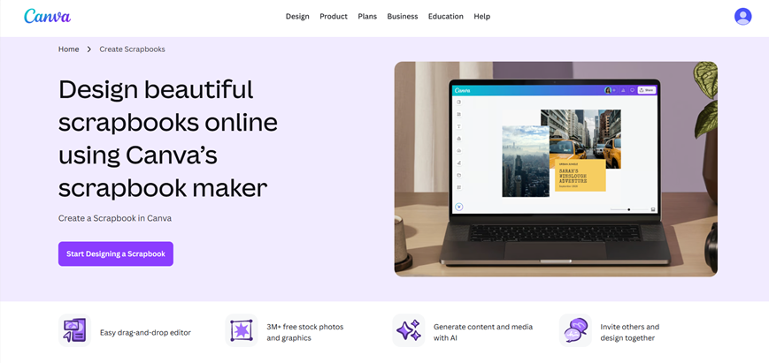

*Hình 2.2. Giao diện giới thiệu công cụ Scrapbook của Canva. Nguồn: Canva.*

Trang giới thiệu Scrapbook của Canva sử dụng bố cục hai phần rõ ràng. Bên trái là tiêu đề lớn, đoạn giới thiệu và nút "Start Designing a Scrapbook"; bên phải là hình ảnh minh họa công cụ thiết kế trên máy tính.

Màu sắc chủ đạo nhẹ nhàng, các khoảng trắng được bố trí hợp lý giúp nội dung trở nên dễ quan sát. Hình ảnh minh họa cho phép người dùng hình dung kết quả thiết kế trước khi bắt đầu sử dụng.

Phía dưới khu vực giới thiệu, Canva trình bày các lợi ích nổi bật như chỉnh sửa kéo thả, thư viện hình ảnh, công cụ hỗ trợ bằng AI và khả năng cộng tác.

Điểm mạnh: Giao diện trực quan, có tiêu đề rõ ràng và nút hành động nổi bật, giúp người dùng dễ dàng bắt đầu quá trình thiết kế.

Điểm hạn chế: Trang tập trung vào công cụ thiết kế hơn là thông tin mua sắm, nên chưa thể hiện đầy đủ các yếu tố như giá bán, chất liệu hoặc tùy chọn sản phẩm vật lý.

Bài học cho Memoria Lab: Trang giới thiệu Studio Customize Scrapbook nên sử dụng hình ảnh minh họa trước và sau khi tùy chỉnh, kết hợp nút "Bắt đầu thiết kế" ở vị trí dễ nhìn.

### 2.3. Phân tích điều hướng (Navigation)

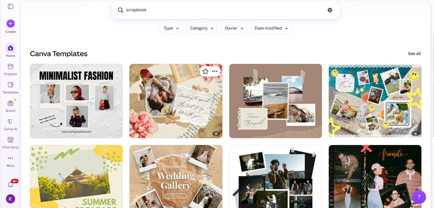

*Hình 2.3. Giao diện tìm kiếm và lựa chọn mẫu thiết kế Scrapbook.*

Canva cho phép người dùng tiếp cận các mẫu thiết kế thông qua thanh tìm kiếm, danh mục và thư viện template.

Khi nhập từ khóa "scrapbook", hệ thống hiển thị nhiều mẫu theo phong cách khác nhau, kèm hình ảnh xem trước.

Trong giao diện được khảo sát, khu vực tìm kiếm có các lựa chọn Type, Category, Owner và Date modified. Đây là những công cụ hỗ trợ tổ chức và thu hẹp kết quả trong thư viện thiết kế.

Sau khi lựa chọn mẫu, người dùng có thể chuyển đến khu vực Editor để chỉnh sửa nội dung.

Điểm mạnh: Luồng điều hướng từ tìm kiếm đến lựa chọn mẫu và chỉnh sửa được tổ chức tương đối rõ ràng.

Điểm hạn chế: Do Canva cung cấp nhiều loại thiết kế khác nhau, người dùng mới có thể phải tìm hiểu nhiều nhóm công cụ trước khi tiếp cận đúng chức năng mong muốn.

Bài học cho Memoria Lab: Nên xây dựng luồng điều hướng đơn giản:

Chọn sản phẩm → Chọn mẫu → Cá nhân hóa → Xem trước → Đặt mua.

Cách tổ chức này giúp khách hàng tập trung vào mục tiêu tạo quà tặng mà không cần thao tác qua quá nhiều công cụ.

### 2.4. Phân tích sản phẩm và danh mục (Product)

Canva cung cấp nhiều mẫu scrapbook theo các chủ đề như sinh nhật, gia đình, du lịch, tình yêu, tốt nghiệp và các dịp kỷ niệm.

Mỗi mẫu có phong cách thiết kế riêng về màu sắc, hình ảnh, bố cục và cách sắp xếp văn bản.

Người dùng có thể thay đổi hình ảnh mẫu bằng ảnh cá nhân và chỉnh sửa nội dung để tạo ra sản phẩm riêng.

Bên cạnh các sản phẩm thiết kế kỹ thuật số, Canva còn có dịch vụ Canva Print dành cho những sản phẩm và khu vực được hỗ trợ.

Tuy nhiên, cần phân biệt mẫu thiết kế với sản phẩm thương mại. Mẫu thiết kế chủ yếu xác định bố cục và nội dung, trong khi sản phẩm thương mại cần có các thông tin như giá bán, chất liệu, kích thước và tùy chọn giao hàng.

Điểm mạnh: Thư viện mẫu phong phú, có nhiều chủ đề và phong cách phù hợp với các nhu cầu cá nhân hóa khác nhau.

Điểm hạn chế: Canva không tập trung quản lý sản phẩm quà tặng vật lý theo mô hình cửa hàng chuyên biệt.

Bài học cho Memoria Lab: Cần tổ chức dữ liệu sản phẩm và mẫu thiết kế riêng biệt.

Ví dụ, khách hàng lựa chọn một sản phẩm scrapbook vật lý, sau đó chọn template phù hợp để cá nhân hóa. Khi đặt hàng, hệ thống phải lưu được sản phẩm đã chọn cùng với nội dung thiết kế tương ứng.

### 2.5. Phân tích tìm kiếm và bộ lọc (Search & Filter)

Canva hỗ trợ tìm kiếm mẫu thiết kế theo từ khóa và chủ đề.

Người dùng có thể nhập các từ như Scrapbook, Birthday, Graduation hoặc Travel để tìm những mẫu liên quan.

Trong quá trình chỉnh sửa, thanh tìm kiếm còn hỗ trợ tìm kiếm hình ảnh, sticker, biểu tượng và các thành phần đồ họa.

Cần phân biệt việc lọc mẫu thiết kế với việc lọc sản phẩm thương mại. Các tiêu chí Type, Category hoặc Date modified trong thư viện thiết kế không tương đương bộ lọc sản phẩm theo khoảng giá, chất liệu hoặc kích thước.

Điểm mạnh: Hỗ trợ tìm kiếm nhanh và tiếp cận nguồn tài nguyên thiết kế phong phú.

Điểm hạn chế: Các bộ lọc thiên về tài nguyên và mẫu thiết kế, không trực tiếp phục vụ việc so sánh sản phẩm vật lý theo các tiêu chí mua sắm.

Bài học cho Memoria Lab: Nên phát triển hai nhóm tìm kiếm:

Tìm sản phẩm theo loại quà, dịp tặng và các thuộc tính thương mại.

Tìm mẫu thiết kế và các thành phần trang trí bên trong Studio.

### 2.6. Phân tích giỏ hàng (Cart)

Đối với hoạt động thiết kế scrapbook thông thường, Canva không lấy giỏ hàng làm chức năng trọng tâm.

Tuy nhiên, theo tài liệu chính thức về Canva Print, khách hàng có thể lựa chọn sản phẩm in, kiểm tra thiết kế và thêm sản phẩm vào giỏ hàng khi dịch vụ hỗ trợ.

Chức năng này cho phép kết nối bản thiết kế kỹ thuật số với quá trình đặt mua sản phẩm vật lý.

Theo hướng dẫn của Canva, nếu người dùng muốn đặt các phiên bản thiết kế hoặc cấu hình in khác nhau, hệ thống có thể quản lý chúng thành các mục riêng trong giỏ hàng.

Đánh giá: Đây là mô hình phù hợp để tham khảo cách liên kết sản phẩm với phiên bản thiết kế cụ thể.

Giới hạn khảo sát: Phân tích này dựa trên tài liệu Canva Print chính thức; nhóm chưa thực hiện giao dịch đặt in hoàn chỉnh.

Bài học cho Memoria Lab: Khi khách hàng hoàn thành thiết kế, hệ thống cần lưu riêng cấu hình thiết kế của mỗi sản phẩm trong giỏ hàng.

Hai sản phẩm cùng loại nhưng có hình ảnh hoặc lời nhắn khác nhau phải được quản lý như hai mục giỏ hàng khác nhau.

Nguồn: https://www.canva.com/help/order-prints/

### 2.7. Phân tích thanh toán (Checkout)

Theo tài liệu trợ giúp Canva Print, quy trình đặt in gồm các bước lựa chọn thông số in, kiểm tra bản thiết kế, nhập thông tin giao hàng, lựa chọn phương thức thanh toán và xác nhận đơn.

Trong quá trình này, hệ thống có bước kiểm tra bản thiết kế trước khi hoàn tất đặt hàng.

Điểm đáng chú ý là khách hàng được yêu cầu xem lại nội dung sản phẩm để hạn chế các lỗi trước khi in.

Điểm mạnh: Có bước kiểm tra bản thiết kế trước khi thực hiện giao dịch, phù hợp với sản phẩm được cá nhân hóa.

Giới hạn khảo sát: Nhóm chưa có minh chứng kiểm thử toàn bộ quy trình thanh toán hoặc các trường hợp giao dịch thất bại.

Bài học cho Memoria Lab: Cần có bước xem trước và xác nhận bản thiết kế trước khi tạo đơn hàng.

Sau khi khách xác nhận, hệ thống phải lưu lại phiên bản thiết kế tương ứng để phục vụ xử lý đơn.

### 2.8. Phân tích khuyến mãi (Promotion)

Canva cung cấp các tài nguyên thiết kế miễn phí và trả phí. Ngoài ra, theo tài liệu Canva Print, dịch vụ in ấn có hỗ trợ nhập coupon tại checkout trong phạm vi áp dụng.

Tuy nhiên, hệ thống khuyến mãi của Canva không phải đối tượng tham khảo chính của dự án vì nền tảng tập trung vào dịch vụ thiết kế.

Điểm mạnh: Có cơ chế áp dụng mã ưu đãi trong quy trình đặt in.

Giới hạn khảo sát: Nhóm chưa thực hiện thử nghiệm với mã coupon hợp lệ hoặc không hợp lệ.

Bài học cho Memoria Lab: Nên xây dựng module khuyến mãi riêng, cho phép người dùng nhập voucher, kiểm tra điều kiện và cập nhật tổng tiền đơn hàng.

### 2.9. Phân tích trải nghiệm người dùng (UX)

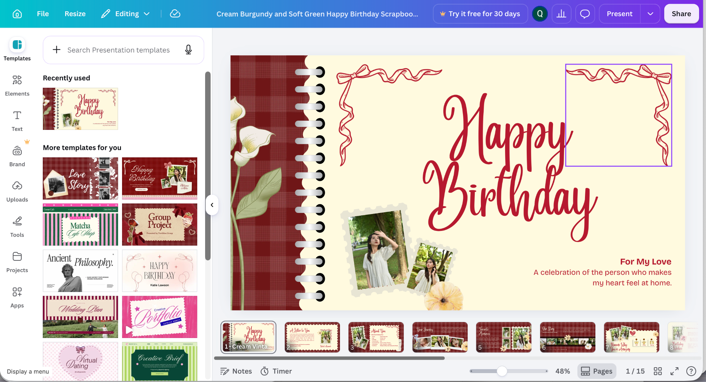

*Hình 2.9. Giao diện Canva Editor với thanh công cụ và vùng thiết kế.*

Canva Editor được chia thành hai khu vực chính.

Bên trái là thanh công cụ cho phép truy cập template, thành phần đồ họa, văn bản và hình ảnh tải lên.

Khu vực trung tâm là vùng thiết kế, nơi người dùng trực tiếp quan sát và thay đổi nội dung.

Các thao tác chỉnh sửa được Canva hỗ trợ gồm thêm hình ảnh, thay đổi kích thước, di chuyển thành phần và chỉnh sửa văn bản.

Điểm mạnh: Giao diện trực quan, người dùng có thể tương tác với các đối tượng thiết kế mà không cần kiến thức lập trình hay đồ họa chuyên sâu.

Điểm hạn chế: Số lượng công cụ lớn có thể tạo ra khó khăn cho người mới khi phải lựa chọn quá nhiều chức năng.

Bài học cho Memoria Lab: Không cần xây dựng trình thiết kế phức tạp như Canva. Studio của nhóm nên ưu tiên thao tác đơn giản, số lượng công cụ giới hạn và khả năng xem trước.

### 2.10. Quy trình sử dụng tham khảo

Quy trình sử dụng Canva trong phạm vi scrapbook được tổng hợp như sau:

Truy cập website và tìm kiếm mẫu scrapbook.

Lựa chọn template hoặc thiết kế trống.

Tải hình ảnh cá nhân lên.

Thêm văn bản, sticker và các thành phần trang trí.

Điều chỉnh bố cục và xem trước.

Lưu, tải xuống hoặc chia sẻ thiết kế.

Nếu sử dụng Canva Print tại khu vực được hỗ trợ, khách hàng có thể tiếp tục quy trình lựa chọn cấu hình in và đặt mua.

Quy trình này thể hiện khả năng kết hợp thiết kế trực tuyến với một số hình thức sử dụng sản phẩm vật lý.

### 2.11. Đánh giá điểm mạnh và điểm yếu

| Điểm mạnh | Điểm hạn chế |
|---|---|
| Kho mẫu scrapbook phong phú | Nhiều công cụ có thể gây khó khăn cho người mới |
| Giao diện chỉnh sửa trực quan | Không tập trung chuyên biệt vào kinh doanh quà tặng |
| Hỗ trợ tải ảnh và cá nhân hóa | Bộ lọc chủ yếu phục vụ mẫu thiết kế |
| Cho phép xem trước thành phẩm | Quy trình mua sản phẩm vật lý không phải trọng tâm |
| Có khả năng chia sẻ và tải thiết kế | Canva Print phụ thuộc loại sản phẩm và khu vực hỗ trợ |

### 2.12. Đề xuất áp dụng cho Memoria Lab

Từ Canva, nhóm rút ra ba hướng học hỏi chính.

Thứ nhất, tổ chức thư viện template và sticker theo chủ đề để khách bắt đầu thiết kế nhanh chóng.

Thứ hai, xây dựng Custom Studio cho phép tải ảnh, thêm chữ/sticker, kéo thả, thay đổi kích thước, xoay/lật và sắp xếp thứ tự lớp trong vùng thiết kế; khung chuẩn được khóa để giữ đúng quy cách sản phẩm.

Thứ ba, hiển thị preview 2D, lưu cấu hình để mở lại và tạo PNG phục vụ kiểm tra/in theo tiêu chuẩn đã chốt. Preview hoặc mockup không được dùng thay file in.

Memoria Lab học hỏi thao tác thiết kế trực quan nhưng không xây toàn bộ công cụ đa mục đích của Canva, không triển khai thiết kế nhiều trang phức tạp hoặc cộng tác đồng thời. Lựa chọn thư viện canvas và thông số ảnh/file in được chốt qua thử kỹ thuật, không tự loại kéo thả khỏi phạm vi đã thống nhất.

## 3. KHẢO SÁT WEBSITE THỨ HAI: MIXBOOK

Website: https://www.mixbook.com/

Trang Photo Books: https://www.mixbook.com/all-photo-books

### 3.1. Giới thiệu tổng quan

Mixbook là nền tảng cung cấp dịch vụ thiết kế và đặt in các sản phẩm ảnh cá nhân hóa, nổi bật là photo book.

Người dùng có thể lựa chọn mẫu thiết kế, tải ảnh cá nhân lên, chỉnh sửa bố cục, thêm nội dung và đặt mua sản phẩm hoàn thiện.

Khác với Canva, Mixbook có định hướng rõ hơn về việc chuyển một thiết kế kỹ thuật số thành sản phẩm vật lý.

Đây là website có giá trị tham khảo đối với Memoria Lab trong việc xây dựng quy trình lựa chọn mẫu, tùy chỉnh sản phẩm, quản lý giỏ hàng và thực hiện đặt mua.

### 3.2. Phân tích giao diện (Layout)

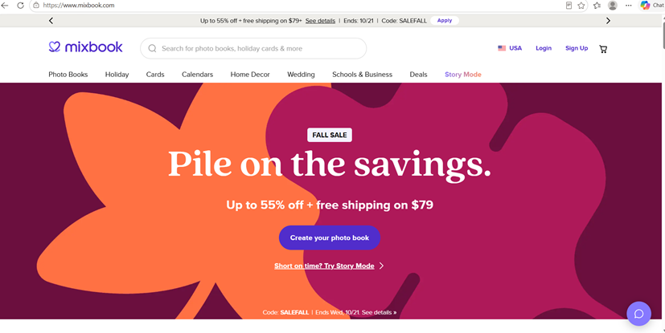

*Hình 3.2. Giao diện trang chủ Mixbook với banner chương trình khuyến mãi.*

Trang chủ Mixbook sử dụng banner lớn để giới thiệu các chương trình ưu đãi, kết hợp nút hành động giúp khách hàng bắt đầu tạo photo book.

Thanh điều hướng nằm ở đầu trang, hiển thị những nhóm sản phẩm chính như Photo Books, Cards, Calendars và Home Decor.

Thanh tìm kiếm được bố trí gần logo, tạo điều kiện cho người dùng tìm kiếm sản phẩm.

Trong ảnh khảo sát, banner khuyến mãi sử dụng màu sắc nổi bật và thông điệp giảm giá lớn để thu hút sự chú ý.

Điểm mạnh: Giao diện nhấn mạnh sản phẩm và chương trình khuyến mãi, giúp khách hàng nhanh chóng tiếp cận nội dung nổi bật.

Điểm hạn chế: Banner có kích thước lớn, chiếm đáng kể không gian đầu trang trước khi người dùng xem danh sách sản phẩm.

Bài học cho Memoria Lab: Nên sử dụng banner để giới thiệu sản phẩm nổi bật hoặc chương trình khuyến mãi, nhưng cần giữ các danh mục quà tặng ở vị trí dễ truy cập.

### 3.3. Phân tích điều hướng (Navigation)

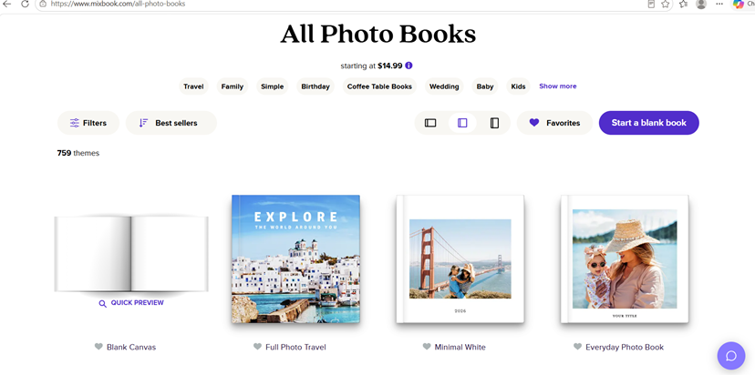

*Hình 3.3. Giao diện danh sách Photo Books trên Mixbook.*

Mixbook tổ chức danh mục theo loại sản phẩm và chủ đề.

Trong trang All Photo Books, khách hàng có thể khám phá các mẫu theo những chủ đề như Travel, Family, Birthday, Wedding và các dịp khác.

Ngoài ra, website hiển thị hình ảnh mẫu, tên sản phẩm và những lựa chọn giúp khách hàng tiếp cận các thiết kế phù hợp.

Điểm mạnh: Cách phân loại theo chủ đề và sự kiện giúp khách hàng nhanh chóng tìm được nhóm sản phẩm phù hợp với mục đích sử dụng.

Điểm hạn chế: Số lượng mẫu lớn có thể khiến quá trình lựa chọn kéo dài nếu người dùng chưa xác định phong cách mong muốn.

Bài học cho Memoria Lab: Nên tổ chức điều hướng theo cả loại quà tặng và dịp tặng.

Ví dụ, khách có thể tìm scrapbook theo loại sản phẩm hoặc theo các dịp như sinh nhật, tốt nghiệp và kỷ niệm tình yêu.

### 3.4. Phân tích sản phẩm và danh mục (Product)

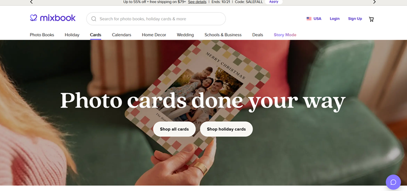

*Hình 3.4.1 Trang giới thiệu sản phẩm thiệp ảnh cá nhân hóa của Mixbook.*

Ngoài photo book, Mixbook còn cung cấp nhiều dòng sản phẩm liên quan đến ảnh cá nhân hóa như thiệp, lịch và sản phẩm trang trí.

Đối với photo book, người dùng có thể lựa chọn mẫu và các thông số như kích thước, kiểu bìa, chất liệu giấy hoặc số trang tùy từng sản phẩm.

Các thông số này ảnh hưởng đến hình thức thành phẩm và giá bán.

Nguồn: https://www.mixbook.com/inspiration/mixbook-order-guide

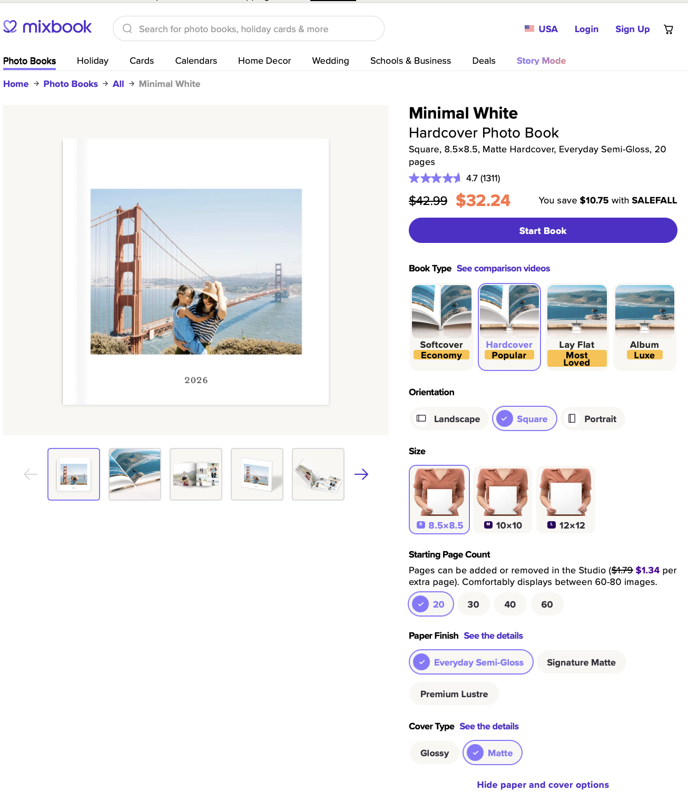

*Hình 3.4.2 Minh họa cách lựa chọn cấu hình photo book theo tài liệu hướng dẫn của Mixbook.*

Điểm mạnh: Cho phép khách hàng cá nhân hóa cả nội dung thiết kế và đặc điểm vật lý của sản phẩm.

Điểm hạn chế: Có nhiều lựa chọn về kích thước, bìa và chất liệu, khiến khách hàng cần tìm hiểu sự khác biệt giữa các phiên bản trước khi mua.

Bài học cho Memoria Lab: Nên thiết kế hệ thống thuộc tính sản phẩm rõ ràng. Mỗi lựa chọn về kích thước hoặc chất liệu cần có mô tả và mức giá tương ứng.

Ở giai đoạn đầu, nhóm nên giới hạn số lượng biến thể để giảm độ phức tạp khi xây dựng và quản lý dữ liệu.

### 3.5. Phân tích tìm kiếm và bộ lọc (Search & Filter)

Mixbook hỗ trợ tìm kiếm sản phẩm thông qua thanh tìm kiếm, hệ thống danh mục và bộ lọc mẫu thiết kế. Tại trang All Photo Books, người dùng có thể tìm kiếm các mẫu theo chủ đề như Travel, Family, Birthday và Wedding, đồng thời sử dụng chức năng Filters để thu hẹp danh sách theo nhu cầu cá nhân.

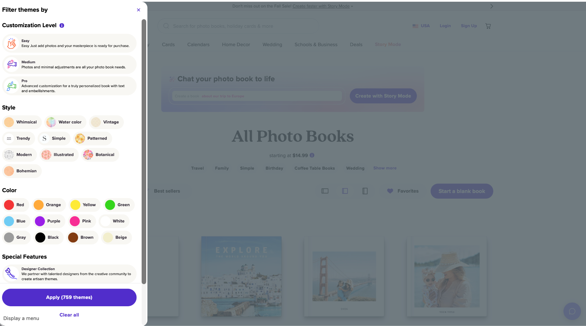

*Hình 3.5. Giao diện bộ lọc mẫu thiết kế của Mixbook theo mức độ tùy chỉnh, phong cách, màu sắc và tính năng đặc biệt. Nguồn: Mixbook, ảnh khảo sát của nhóm.*

Qua giao diện khảo sát, Mixbook cung cấp bộ lọc gồm bốn nhóm tiêu chí chính:

Thứ nhất, mức độ tùy chỉnh (Customization Level):

Easy: Người dùng chỉ cần thêm ảnh vào mẫu có sẵn, phù hợp với người muốn hoàn thành sản phẩm nhanh chóng.

Medium: Cho phép thêm ảnh và thực hiện một số điều chỉnh cơ bản.

Pro: Hướng đến người dùng muốn cá nhân hóa chuyên sâu hơn bằng văn bản và các thành phần trang trí.

Thứ hai, phong cách thiết kế (Style):

Mixbook cung cấp nhiều phong cách như Whimsical, Water Color, Vintage, Trendy, Simple, Patterned, Modern, Illustrated, Botanical và Bohemian.

Nhờ đó, khách hàng có thể lựa chọn mẫu phù hợp với sở thích hoặc ý nghĩa của món quà thay vì phải xem toàn bộ thư viện.

Thứ ba, màu sắc (Color):

Người dùng có thể lọc mẫu theo các màu như Red, Orange, Yellow, Green, Blue, Purple, Pink, White, Gray, Black, Brown và Beige.

Chức năng này hữu ích khi khách hàng đã có định hướng về màu sắc hoặc phong cách thiết kế mong muốn.

Thứ tư, tính năng đặc biệt (Special Features):

Mixbook cung cấp tùy chọn Designer Collection, giúp người dùng khám phá những mẫu thiết kế được tạo bởi cộng đồng nhà thiết kế hợp tác với nền tảng.

Sau khi lựa chọn các điều kiện, người dùng có thể nhấn Apply để áp dụng bộ lọc hoặc Clear all để xóa các lựa chọn.

Điểm mạnh:

Bộ lọc được phân chia thành những nhóm tiêu chí rõ ràng, giúp khách hàng thu hẹp danh sách mẫu theo phong cách, màu sắc và mức độ tùy chỉnh. Đặc biệt, việc phân loại Easy, Medium và Pro hỗ trợ người dùng lựa chọn mẫu phù hợp với khả năng thiết kế của bản thân.

Điểm hạn chế:

Số lượng phong cách và tùy chọn tương đối nhiều có thể khiến người dùng mới cần thời gian tìm hiểu. Ngoài ra, các tiêu chí trong bộ lọc tập trung chủ yếu vào đặc điểm của mẫu thiết kế, chưa trực tiếp giải quyết nhu cầu lọc sản phẩm theo giá bán hoặc chất liệu vật lý.

Bài học cho Memoria Lab:

Nhóm có thể tham khảo cách Mixbook tổ chức bộ lọc theo phong cách và màu sắc để áp dụng cho thư viện mẫu scrapbook. Tuy nhiên, để phù hợp với phạm vi đồ án, Memoria Lab nên ưu tiên các tiêu chí đơn giản như chủ đề, phong cách thiết kế và màu sắc.

Đối với khu vực cửa hàng, Memoria Lab triển khai bộ lọc theo loại sản phẩm, kích thước, chất liệu, khoảng giá và chủ đề, thống nhất với REQUIREMENTS.md; bộ lọc template được phân biệt với bộ lọc sản phẩm.

Việc tách bộ lọc mẫu thiết kế khỏi bộ lọc sản phẩm thương mại giúp người dùng dễ dàng tìm kiếm, đồng thời giữ cho giao diện và quá trình phát triển hệ thống không quá phức tạp.

### 3.6. Phân tích giỏ hàng (Cart)

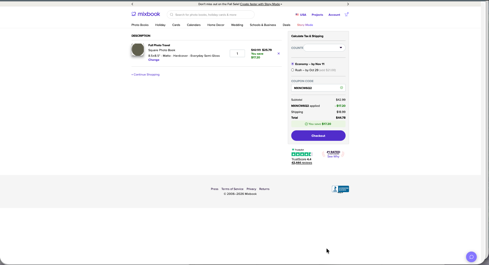

*Hình 3.6. Giao diện giỏ hàng Mixbook với thông tin sản phẩm, số lượng, tùy chọn vận chuyển và mã giảm giá đã áp dụng.*

Qua quá trình khảo sát, nhóm đã tạo một sản phẩm Photo Book và chuyển sản phẩm vào giỏ hàng trên Mixbook.

Trong giao diện giỏ hàng, website hiển thị tên sản phẩm, hình ảnh xem trước, loại sách, kích thước, chất liệu và số lượng.

Người dùng có thể điều chỉnh số lượng, xóa sản phẩm hoặc sử dụng liên kết "Change" để thay đổi cấu hình. Ngoài ra còn có liên kết "Continue Shopping" để quay lại mua sắm.

Đặc biệt, khu vực bên phải cung cấp chức năng tính thuế và phí vận chuyển, lựa chọn hình thức giao hàng và áp dụng mã coupon.

Trong ảnh khảo sát, nhóm đã áp dụng thành công một mã giảm giá cho sản phẩm.

Bảng tổng kết đơn hàng thể hiện:

| Khoản mục | Giá trị trong ảnh khảo sát |
|---|---|
| Giá sản phẩm trước giảm | 42,99 USD |
| Giảm giá coupon | −17,20 USD |
| Giá sản phẩm sau giảm | 25,79 USD |
| Phí vận chuyển | 18,99 USD |
| Tổng tiền | 44,78 USD |

Giá trị này phản ánh cấu hình và điều kiện tại thời điểm khảo sát, không phải giá cố định của Mixbook.

Điểm mạnh: Giỏ hàng hiển thị đầy đủ cấu hình sản phẩm, số lượng, mức giảm giá và tổng tiền. Các thành phần được bố trí thành hai khu vực riêng, giúp người mua kiểm tra thông tin trước khi thanh toán.

Điểm hạn chế: Việc thay đổi một số thông số sản phẩm cần chuyển qua giao diện chỉnh sửa cấu hình, thay vì thực hiện trực tiếp tất cả thao tác tại giỏ hàng.

Bài học cho Memoria Lab: Giỏ hàng phải lưu được cấu hình của từng sản phẩm cá nhân hóa. Khách hàng cần có khả năng kiểm tra hình ảnh xem trước, giá, số lượng, phí vận chuyển và mức giảm giá trước khi đặt mua.

Nếu hai sản phẩm cùng loại nhưng sử dụng hình ảnh hoặc nội dung thiết kế khác nhau, hệ thống phải lưu chúng thành hai mục giỏ hàng riêng biệt.

### 3.7. Phân tích thanh toán (Checkout)

Mixbook tổ chức quy trình mua hàng theo hướng người dùng hoàn thiện thiết kế, lựa chọn cấu hình sản phẩm và kiểm tra giỏ hàng trước khi chuyển sang checkout.

Trong giao diện giỏ hàng đã khảo sát, hệ thống cho phép lựa chọn hình thức giao hàng Economy hoặc Rush.

Mỗi hình thức đi kèm thông tin thời gian giao dự kiến. Hình thức Rush có thể phát sinh thêm chi phí.

Website cũng cung cấp khu vực tính thuế và vận chuyển theo quốc gia giao hàng, bảng tổng kết chi phí và nút "Checkout".

Điểm mạnh: Người dùng có thể quan sát các khoản chi phí và lựa chọn giao hàng trước khi tiếp tục quá trình thanh toán. Điều này giúp giảm sự bất ngờ về tổng tiền khi mua hàng.

Giới hạn khảo sát: Nhóm đã trực tiếp kiểm tra giao diện cấu hình và giỏ hàng nhưng chưa hoàn tất bước nhập thông tin thanh toán và xác nhận giao dịch. Vì vậy, chưa có căn cứ đánh giá toàn bộ quy trình xử lý giao dịch thành công, thất bại hoặc hủy.

Bài học cho Memoria Lab: Cần xây dựng checkout hiển thị rõ thông tin sản phẩm, bản thiết kế đã xác nhận, địa chỉ giao hàng, phí vận chuyển, khuyến mãi và tổng tiền.

Hệ thống backend phải quản lý trạng thái thanh toán riêng với trạng thái xử lý đơn hàng.

### 3.8. Phân tích khuyến mãi (Promotion)

Mixbook có chương trình khuyến mãi được giới thiệu trên trang chủ và hỗ trợ nhập mã coupon trong quá trình đặt hàng.

Đáng chú ý, qua thao tác khảo sát thực tế, nhóm đã nhập và áp dụng thành công một mã giảm giá tại trang cấu hình sản phẩm. Trạng thái giảm giá tiếp tục được hiển thị trong giỏ hàng.

Trong ảnh khảo sát, hệ thống ghi nhận khoản giảm giá 17,20 USD, đồng thời cập nhật giá sản phẩm từ 42,99 USD xuống còn 25,79 USD.

Phần tổng kết thể hiện riêng giá sản phẩm, số tiền được giảm, phí vận chuyển và tổng tiền.

Điểm mạnh: Mã giảm giá được kiểm tra và áp dụng trực tiếp trên giao diện. Hệ thống hiển thị rõ số tiền tiết kiệm và cập nhật tổng giá trị đơn hàng, giúp người mua dễ dàng nhận biết lợi ích của chương trình ưu đãi.

Điểm hạn chế: Việc áp dụng coupon làm bảng tổng kết có nhiều mức giá khác nhau, gồm giá gốc, giá sau giảm và tổng tiền đã cộng vận chuyển. Khách hàng cần đọc kỹ để phân biệt các khoản này.

Bài học cho Memoria Lab: Chức năng voucher cần cho phép nhập mã, xác minh điều kiện sử dụng và cập nhật tổng tiền.

Nên trình bày rõ giá gốc, số tiền giảm, phí vận chuyển và số tiền cuối cùng nhằm hạn chế nhầm lẫn cho khách hàng.

### 3.9. Phân tích trải nghiệm người dùng (UX)

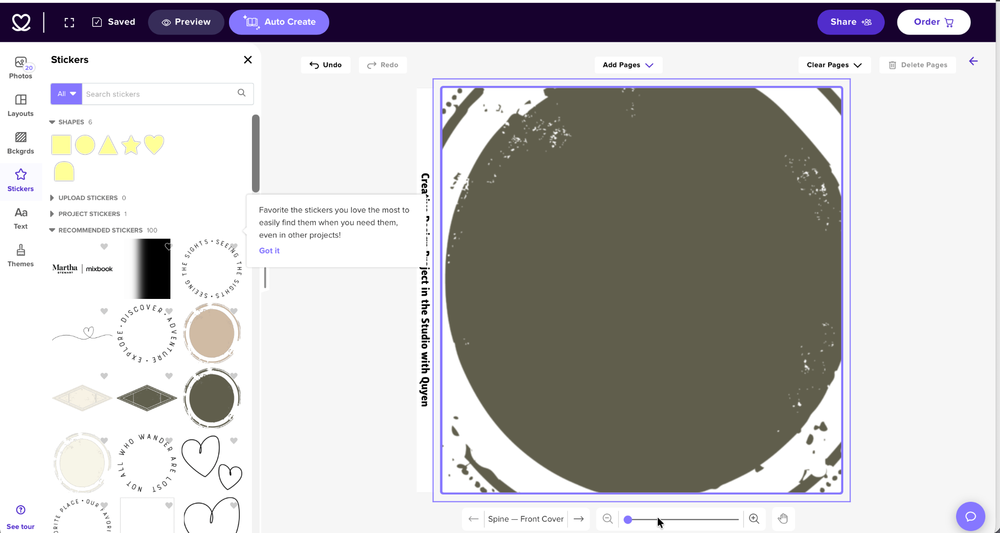

*Hình 3.9. Giao diện Mixbook Studio với thanh công cụ Sticker, vùng thiết kế, điều khiển trang và các chức năng chỉnh sửa.*

Qua ảnh khảo sát trực tiếp, Mixbook Studio cung cấp giao diện thiết kế gồm thanh công cụ bên trái và vùng chỉnh sửa sản phẩm ở giữa.

Các nhóm chức năng trong thanh công cụ gồm Photos, Layouts, Backgrounds, Stickers, Text và Themes.

Người dùng có thể lựa chọn hình ảnh, bố cục, nền, sticker và văn bản để tạo ra sản phẩm cá nhân hóa.

Trong khu vực Stickers, Mixbook cung cấp các nhóm hình trang trí, biểu tượng và sticker được đề xuất. Người dùng có thể tìm kiếm thành phần phù hợp thông qua thanh tìm kiếm.

Phía trên vùng thiết kế có các chức năng Undo, Redo, Add Pages, Clear Pages và Delete Pages.

Thanh điều hướng trên cùng cung cấp những nút như Preview, Auto Create, Share và Order. Giao diện còn có trạng thái Saved để thông báo nội dung thiết kế đã được lưu.

Ở phía dưới, người dùng có thể chuyển trang, thay đổi mức thu phóng và kiểm tra khu vực đang chỉnh sửa.

Điểm mạnh: Giao diện phân chia rõ vùng công cụ và vùng thiết kế, hỗ trợ nhiều thao tác chỉnh sửa và xem trước. Các chức năng Undo, Preview và trạng thái Saved giúp người dùng kiểm soát quá trình tạo sản phẩm.

Điểm hạn chế: Số lượng công cụ khá nhiều, có thể làm người mới mất thời gian làm quen. Trong ảnh khảo sát, hộp gợi ý hướng dẫn cũng che một phần khu vực thao tác, gây gián đoạn quan sát tạm thời.

Ngoài ra, khi thêm thành phần trang trí có kích thước lớn, người dùng cần tự kiểm tra để tránh che khuất hình ảnh hoặc nội dung khác trong bản thiết kế.

Bài học cho Memoria Lab: Studio nên có bố cục đơn giản, chỉ tập trung vào những thao tác như chọn mẫu, tải ảnh, nhập văn bản, thêm sticker và xem trước.

Nhóm chưa cần phát triển đầy đủ các tính năng quản lý nhiều trang, cộng tác hoặc tự động thiết kế như Mixbook.

Template cung cấp bố cục khởi đầu; khách vẫn được kéo thả và chỉnh các đối tượng được phép, trong khi khung chuẩn và ranh giới in được bảo vệ. Nhóm thử kỹ thuật để chọn công cụ phù hợp và kiểm tra lưu/mở, phiên bản và file xuất.

### 3.10. Quy trình giao dịch tham khảo

Dựa trên quá trình khảo sát thực tế, quy trình tạo và đặt mua Photo Book tại Mixbook được tổng hợp như sau:

Truy cập website và lựa chọn sản phẩm Photo Book.

Tìm kiếm, sử dụng bộ lọc và lựa chọn mẫu phù hợp.

Mở Mixbook Studio để tải ảnh, chỉnh sửa văn bản, sticker và bố cục.

Xem trước và kiểm tra bản thiết kế.

Chọn Order để chuyển sang cấu hình sản phẩm.

Lựa chọn loại bìa, kích thước, chất liệu giấy và số lượng.

Kiểm tra giá bán và áp dụng mã giảm giá nếu có.

Thêm sản phẩm vào giỏ hàng.

Kiểm tra cấu hình, phí vận chuyển và tổng tiền.

Chuyển sang Checkout để tiếp tục thanh toán.

Nhóm đã trực tiếp khảo sát đến bước giỏ hàng và áp dụng coupon thành công. Các bước thanh toán cuối cùng chưa được kiểm thử đầy đủ.

### 3.11. Đánh giá điểm mạnh và điểm yếu

| Điểm mạnh | Điểm hạn chế |
|---|---|
| Danh mục Photo Book và mẫu thiết kế phong phú | Nhiều mẫu có thể khiến khách hàng mất thời gian lựa chọn |
| Bộ lọc theo phong cách, màu sắc và mức độ tùy chỉnh | Số lượng tiêu chí lọc tương đối nhiều |
| Studio có công cụ chỉnh sửa, xem trước và Undo/Redo | Giao diện nhiều công cụ có thể gây khó khăn cho người mới |
| Cho phép lựa chọn loại bìa, kích thước và chất liệu | Nhiều tùy chọn làm tăng số bước trước khi mua |
| Giỏ hàng hiển thị cấu hình, số lượng và tổng tiền | Một số thay đổi cấu hình cần chuyển sang giao diện riêng |

### 3.12. Đề xuất áp dụng cho Memoria Lab

Từ kết quả khảo sát Mixbook, nhóm rút ra các định hướng áp dụng:

Thư viện mẫu: Phân loại scrapbook theo chủ đề, phong cách và màu sắc để khách hàng dễ lựa chọn.

Studio Customize: Hỗ trợ chọn template, tải ảnh, thêm văn bản, sticker và xem trước thành phẩm bằng giao diện đơn giản.

Cấu hình sản phẩm: Cho phép lựa chọn kích thước, chất liệu hoặc biến thể phù hợp và cập nhật giá bán.

Giỏ hàng: Lưu riêng bản thiết kế của từng sản phẩm cá nhân hóa, hiển thị thông tin cấu hình, số lượng và giá.

Khuyến mãi và vận chuyển: Hiển thị rõ voucher, phí vận chuyển và tổng tiền trước khi thanh toán.

Memoria Lab nên học hỏi quy trình kết nối thiết kế với đơn hàng của Mixbook, nhưng không triển khai toàn bộ trình chỉnh sửa phức tạp. Nhóm dùng template làm bố cục khởi đầu, giữ thao tác kéo thả ảnh/chữ/sticker và lớp trong phạm vi sản phẩm phẳng một mặt; không xây toàn bộ editor nhiều trang như Mixbook.

## 4. KHẢO SÁT WEBSITE THỨ BA: PHOTOCARE

Website: https://www.photocare.vn/

Danh mục sản phẩm: https://www.photocare.vn/danh-muc/tat-ca-san-pham

### 4.1. Giới thiệu tổng quan

Photocare là website kinh doanh các sản phẩm quà tặng cá nhân hóa tại Việt Nam.

Website cung cấp những sản phẩm như khung ảnh, cốc in hình, pha lê, đèn LED, tranh gương và các sản phẩm in ảnh theo yêu cầu.

Khách hàng có thể lựa chọn sản phẩm, cung cấp hình ảnh cá nhân và nhập nội dung muốn in để cửa hàng tiếp nhận yêu cầu.

Photocare có mô hình tương đồng với Memoria Lab ở hoạt động kinh doanh quà tặng vật lý và xử lý yêu cầu cá nhân hóa.

Đặc biệt, đây là website tại Việt Nam nên phù hợp để khảo sát cách hiển thị giá, tổ chức danh mục và quy trình giao hàng cho khách hàng trong nước.

### 4.2. Phân tích giao diện (Layout)

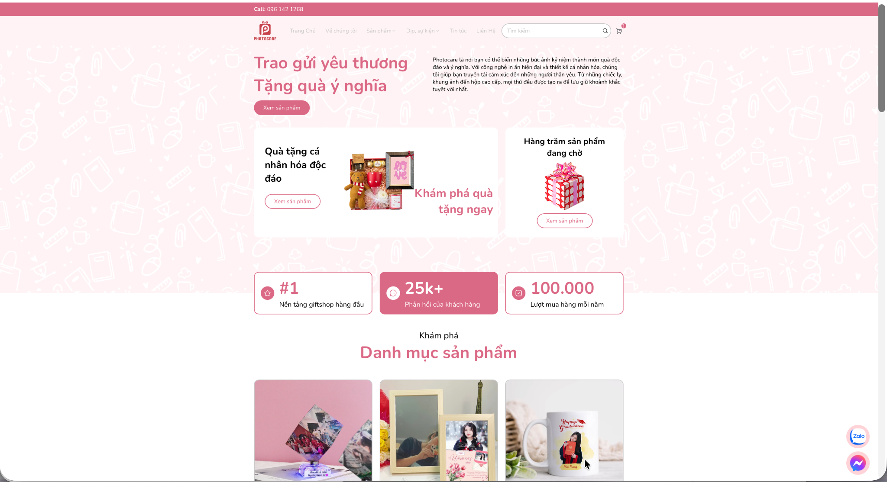

*Hình 4.2. Giao diện trang chủ Photocare.*

Trang chủ Photocare sử dụng tông màu hồng và trắng, tạo cảm giác nhẹ nhàng, phù hợp với lĩnh vực quà tặng cá nhân hóa.

Phần đầu trang có logo, thanh điều hướng, ô tìm kiếm, biểu tượng giỏ hàng và thông tin liên hệ.

Banner giới thiệu thông điệp "Trao gửi yêu thương – Tặng quà ý nghĩa", kết hợp nút "Xem sản phẩm" để điều hướng khách hàng đến khu vực mua sắm.

Bên dưới là các nhóm sản phẩm, hình ảnh quà tặng và thông tin giới thiệu về cửa hàng.

Điểm mạnh: Màu sắc nhất quán, hình ảnh trực quan và thông điệp phù hợp với lĩnh vực kinh doanh.

Điểm hạn chế: Trang chủ chứa nhiều khu vực giới thiệu và hình ảnh, khiến chiều dài trang tương đối lớn.

Bài học cho Memoria Lab: Nên sử dụng phong cách giao diện nhẹ nhàng, giàu cảm xúc nhưng bố cục cần rõ ràng và ưu tiên thông tin sản phẩm.

### 4.3. Phân tích điều hướng (Navigation)

*Hình 4.3.1 Giao diện danh mục sản phẩm Photocare.*

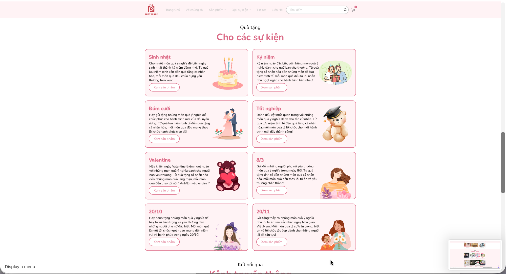

*Hình 4.3.2 Giao diện phân loại quà tặng theo sự kiện.*

Photocare tổ chức điều hướng theo hai hướng chính.

Thứ nhất, phân loại theo loại sản phẩm như khung ảnh, đèn LED, cốc in hình, pha lê và tranh gương.

Thứ hai, phân loại theo dịp tặng như sinh nhật, kỷ niệm, đám cưới, tốt nghiệp, Valentine và các ngày lễ.

Mỗi nhóm được trình bày bằng hình ảnh minh họa, tên danh mục và nút xem sản phẩm.

Điểm mạnh: Hỗ trợ cả người dùng đã biết loại sản phẩm muốn mua lẫn người dùng đang tìm quà cho một dịp cụ thể.

Điểm hạn chế: Khi danh mục mở rộng, việc phân loại theo nhiều hướng có thể khiến một số sản phẩm xuất hiện ở nhiều nhóm, đòi hỏi hệ thống điều hướng rõ ràng để tránh gây nhầm lẫn.

Bài học cho Memoria Lab: Nên kết hợp danh mục theo loại sản phẩm và dịp tặng.

Ví dụ, scrapbook có thể xuất hiện trong danh mục Scrapbook và đồng thời được giới thiệu trong nhóm Quà tốt nghiệp hoặc Quà kỷ niệm.

### 4.4. Phân tích sản phẩm (Product)

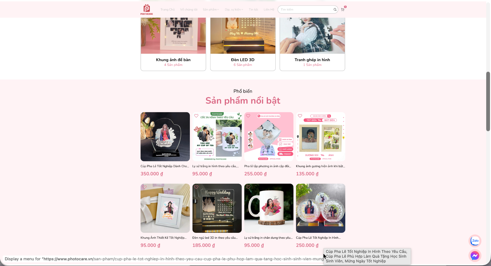

*Hình 4.4.1 Giao diện giới thiệu sản phẩm nổi bật với hình ảnh, tên và giá.*

Photocare trình bày các sản phẩm dưới dạng thẻ, bao gồm hình ảnh minh họa, tên sản phẩm và giá bán bằng VNĐ.

Ví dụ, trong ảnh khảo sát, các sản phẩm gồm cốc in hình, khung ảnh và pha lê cá nhân hóa được hiển thị kèm giá bán.

Tại trang chi tiết một số sản phẩm, khách hàng có thể xem thông tin chất liệu, kích thước và hướng dẫn cung cấp hình ảnh theo yêu cầu.

Đặc biệt, trang sản phẩm khung ảnh thiết kế theo yêu cầu có khu vực tải ảnh lên và nhập nội dung muốn in.

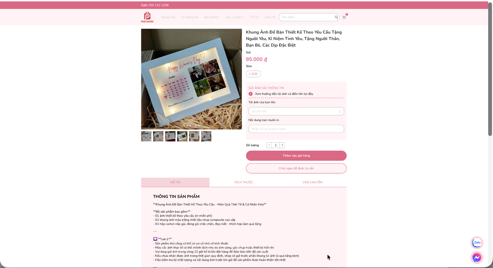

*Hình 4.4.2 Trang chi tiết sản phẩm cho phép khách hàng tải ảnh và nhập nội dung cá nhân hóa.*

Trang này thể hiện việc người dùng cung cấp dữ liệu cho cửa hàng xử lý, thay vì trực tiếp chỉnh sửa các thành phần thiết kế trên một vùng Canvas.

Điểm mạnh: Cung cấp thông tin sản phẩm và cho phép khách gửi ảnh, nội dung cá nhân hóa theo yêu cầu.

Điểm hạn chế: Trên trang sản phẩm được khảo sát, người dùng chưa được cung cấp một công cụ kéo thả trực tiếp để tự điều chỉnh bố cục và xem trước thiết kế hoàn chỉnh.

Bài học cho Memoria Lab: Có thể học hỏi cách Photocare tiếp nhận dữ liệu cá nhân hóa, đồng thời phát triển trải nghiệm xem trước thiết kế đơn giản để khách chủ động kiểm tra trước khi đặt mua.

### 4.5. Phân tích tìm kiếm và bộ lọc (Search & Filter)

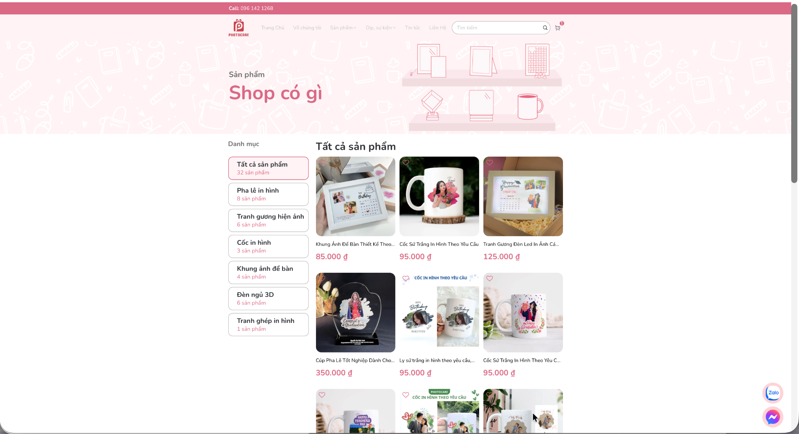

*Hình 4.5. Danh sách sản phẩm và các danh mục của Photocare.*

Photocare cung cấp ô tìm kiếm trên thanh điều hướng và hệ thống danh mục để khách hàng tiếp cận sản phẩm.

Trong trang "Tất cả sản phẩm" được khảo sát, bên trái là danh sách các nhóm như Pha lê in hình, Cốc in hình, Khung ảnh để bàn, Đèn ngủ 3D và Tranh gương hiện ảnh.

Khu vực bên phải hiển thị danh sách sản phẩm cùng hình ảnh, tên và giá bán.

Tuy nhiên, cần phân biệt rõ giữa điều hướng theo danh mục và lọc sản phẩm theo thuộc tính.

Navigation (điều hướng): Người dùng chọn danh mục như Khung ảnh để bàn để xem nhóm sản phẩm tương ứng.

Filter (bộ lọc): Người dùng lựa chọn thêm điều kiện như khoảng giá, chất liệu hoặc màu sắc để thu hẹp các sản phẩm trong cùng danh sách.

Tại giao diện "Tất cả sản phẩm" được khảo sát, Photocare sử dụng chủ yếu hệ thống danh mục và chưa hiển thị bộ lọc đa thuộc tính theo khoảng giá, màu sắc hoặc chất liệu.

Điểm mạnh: Danh mục được trình bày rõ ràng, giúp người dùng nhanh chóng lựa chọn nhóm sản phẩm.

Điểm hạn chế: Việc thiếu bộ lọc đa thuộc tính trên trang được khảo sát khiến khách hàng chưa thể kết hợp nhiều điều kiện để thu hẹp danh sách.

Bài học cho Memoria Lab: Phát triển năm thuộc tính lọc sản phẩm gồm loại sản phẩm, kích thước, chất liệu, khoảng giá và chủ đề; cho phép kết hợp và xóa điều kiện lọc.

Nhờ vậy, khách hàng có thể dễ dàng lựa chọn quà phù hợp với nhu cầu và ngân sách.

### 4.6. Phân tích giỏ hàng (Cart)

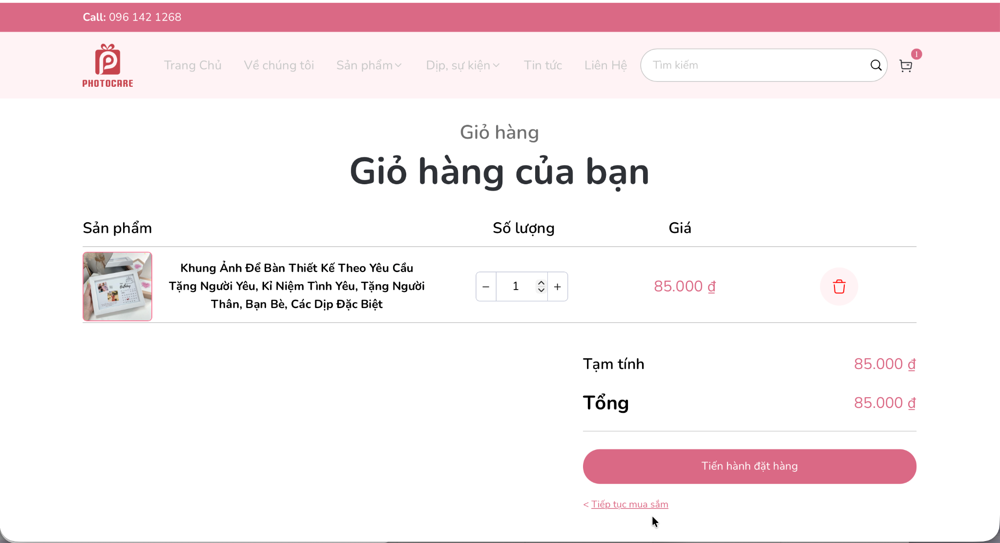

*Hình 4.6. Giao diện giỏ hàng Photocare hiển thị sản phẩm, số lượng và tổng tiền.*

Trong ảnh khảo sát, giỏ hàng Photocare hiển thị thông tin sản phẩm gồm hình ảnh, tên, số lượng và giá bán.

Người dùng được cung cấp các nút tăng hoặc giảm số lượng cùng biểu tượng xóa sản phẩm.

Khu vực bên dưới hiển thị tạm tính, tổng tiền và nút "Tiến hành đặt hàng".

Ngoài ra, website cung cấp liên kết "Tiếp tục mua sắm" để khách hàng quay lại cửa hàng.

Điểm mạnh: Các thông tin và thao tác quan trọng được bố trí rõ ràng, thuận tiện cho việc kiểm tra giỏ hàng.

Điểm hạn chế: Trong ảnh giỏ hàng được khảo sát, chưa có phần xem lại chi tiết hình ảnh hoặc nội dung cá nhân hóa mà khách đã cung cấp.

Đây là hạn chế quan sát được của cách hiển thị trên giao diện, không phải kết luận về dữ liệu mà hệ thống lưu trữ phía backend.

Bài học cho Memoria Lab: Mỗi sản phẩm cá nhân hóa trong giỏ hàng nên hiển thị thông tin hoặc ảnh xem trước của bản thiết kế tương ứng.

Nếu khách mua hai sản phẩm cùng loại nhưng có nội dung thiết kế khác nhau, hệ thống phải quản lý thành hai mục riêng để tránh nhầm lẫn khi sản xuất.

### 4.7. Phân tích thanh toán (Checkout)

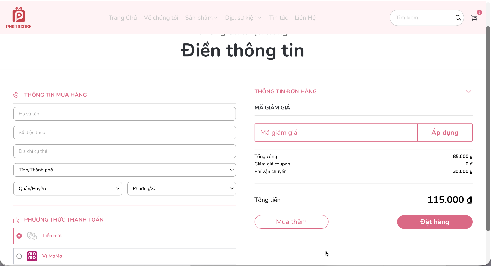

*Hình 4.7. Giao diện nhập thông tin giao hàng và xác nhận đơn hàng trên Photocare.*

Trang checkout được chia thành hai khu vực chính.

Bên trái là thông tin mua hàng gồm họ tên, số điện thoại, địa chỉ cụ thể và các lựa chọn tỉnh/thành phố, quận/huyện, phường/xã.

Bên dưới là khu vực lựa chọn phương thức thanh toán. Trong ảnh khảo sát, hệ thống hiển thị hai lựa chọn: Tiền mặt và Ví MoMo.

Bên phải là phần thông tin đơn hàng, mã giảm giá, phí vận chuyển và tổng tiền.

Trong tình huống khảo sát được chụp lại, một sản phẩm có giá 85.000 đồng, phí vận chuyển 30.000 đồng và tổng tiền là 115.000 đồng.

Điểm mạnh: Thông tin nhận hàng và thông tin đơn được bố trí riêng biệt, giúp khách hàng dễ dàng kiểm tra trước khi xác nhận.

Giới hạn khảo sát: Ảnh cho thấy lựa chọn MoMo xuất hiện trong giao diện, nhưng chưa chứng minh giao dịch được chuyển đến cổng MoMo hoặc xử lý kết quả thanh toán thành công.

Bài học cho Memoria Lab: Nên xây dựng trang checkout ngắn gọn, có kiểm tra dữ liệu đầu vào và hiển thị rõ các khoản tiền.

Bên cạnh giao diện, backend phải lưu trạng thái đơn và xác minh kết quả thanh toán theo đúng yêu cầu của phương thức được tích hợp.

### 4.8. Phân tích khuyến mãi (Promotion)

Tại trang checkout, Photocare cung cấp ô nhập mã giảm giá và nút "Áp dụng".

Khu vực thông tin đơn hàng hiển thị giá trị giảm giá coupon, phí vận chuyển và tổng tiền.

Bên cạnh đó, Photocare công bố chính sách ưu đãi vận chuyển theo số lượng sản phẩm. Theo chính sách được tham khảo, đơn mua từ hai sản phẩm trở lên có thể được miễn phí vận chuyển theo điều kiện áp dụng.

Điểm mạnh: Thông tin giảm giá và phí vận chuyển được kết hợp trong khu vực tổng kết đơn hàng, giúp người mua nhận biết chi phí.

Giới hạn khảo sát: Nhóm chưa xác minh đầy đủ phản hồi khi nhập mã coupon không hợp lệ, hết hạn hoặc không đủ điều kiện.

Bài học cho Memoria Lab: Nên hỗ trợ mã giảm giá có điều kiện, thời hạn và giới hạn sử dụng. Tổng tiền phải được backend tính toán lại sau khi kiểm tra voucher.

Nguồn chính sách vận chuyển: https://www.photocare.vn/chinh-sach-van-chuyen-va-giao-nhan

### 4.9. Phân tích trải nghiệm người dùng (UX)

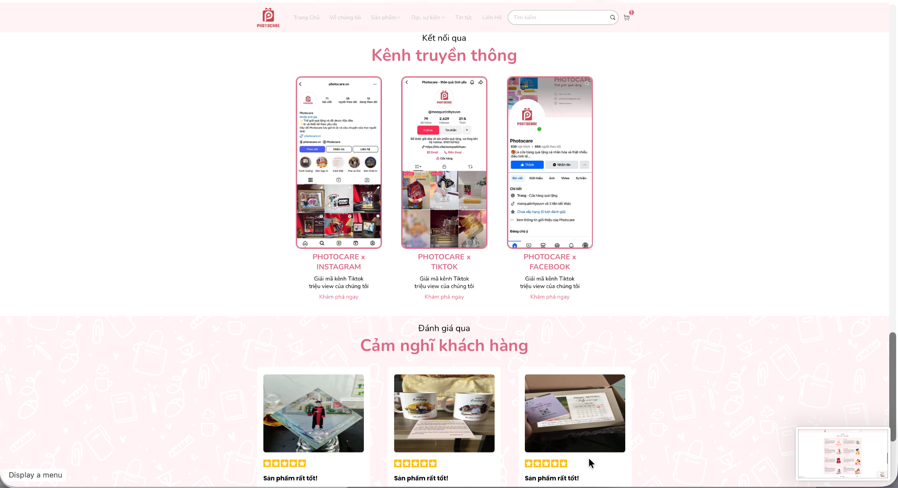

*Hình 4.9. Khu vực truyền thông và phản hồi khách hàng được Photocare giới thiệu trên website.*

Photocare sử dụng tiếng Việt và trình bày giá bán bằng VNĐ, phù hợp với nhu cầu mua sắm trong nước.

Website kết hợp hình ảnh sản phẩm, thông điệp cảm xúc và các nhóm quà tặng theo dịp để giúp người dùng lựa chọn.

Ngoài ra, trang chủ có khu vực liên kết mạng xã hội như Instagram, TikTok và Facebook, cùng phần giới thiệu cảm nhận khách hàng.

Các hình ảnh phản hồi này góp phần tạo cảm giác tin cậy và thể hiện sản phẩm trong bối cảnh sử dụng thực tế. Tuy nhiên, nhóm chưa xác minh tính xác thực độc lập của từng phản hồi.

Điểm mạnh: Nội dung gần gũi với người dùng Việt Nam, kết hợp thông tin mua sắm và yếu tố cảm xúc.

Điểm hạn chế: Với sản phẩm phải gửi ảnh và nội dung cho cửa hàng, khách hàng chưa thể trực tiếp điều chỉnh bản thiết kế hoàn chỉnh ngay tại trang sản phẩm được khảo sát.

Bài học cho Memoria Lab: Nên kết hợp cách trình bày sản phẩm và nội dung giàu cảm xúc của Photocare với công cụ cá nhân hóa trực tiếp để nâng cao sự chủ động của khách hàng.

### 4.10. Quy trình giao dịch tham khảo

Quy trình đặt mua sản phẩm tại Photocare được tổng hợp theo các bước:

Truy cập website và lựa chọn sản phẩm.

Xem hình ảnh, giá bán và thông tin chi tiết.

Chọn tùy chọn sản phẩm nếu có.

Tải ảnh cá nhân hoặc nhập nội dung muốn in theo hướng dẫn.

Thêm sản phẩm vào giỏ hàng.

Kiểm tra số lượng và tổng tiền.

Chuyển sang checkout.

Nhập thông tin nhận hàng.

Kiểm tra phí vận chuyển và mã giảm giá.

Lựa chọn phương thức thanh toán và xác nhận đặt hàng.

Đối với sản phẩm cần xử lý thiết kế riêng, cửa hàng có thể tiếp nhận và thực hiện các bước xử lý tiếp theo theo quy trình của mình.

Các thao tác tạo đơn thành công và xử lý thanh toán thực tế chưa được nhóm xác minh đầy đủ.

### 4.11. Đánh giá điểm mạnh và điểm yếu

| Điểm mạnh | Điểm hạn chế |
|---|---|
| Danh mục quà tặng đa dạng, phù hợp thị trường Việt Nam | Trang chủ có nhiều khu vực nội dung |
| Giao diện có màu sắc và phong cách nhất quán | Một số tên sản phẩm dài và bị cắt bớt trên thẻ sản phẩm |
| Giá bán được hiển thị rõ ràng | Trang danh sách khảo sát chưa có bộ lọc đa thuộc tính |
| Có giỏ hàng và checkout với thông tin giao nhận | Giỏ hàng chưa thể hiện chi tiết bản thiết kế cá nhân hóa trong ảnh khảo sát |
| Có ô nhập mã giảm giá và lựa chọn thanh toán | Trang sản phẩm khảo sát chưa có trình chỉnh sửa kéo thả và xem trước bố cục trực tiếp |

### 4.12. Đề xuất áp dụng cho Memoria Lab

Từ Photocare, nhóm học được cách xây dựng một cửa hàng trực tuyến chuyên về quà tặng cá nhân hóa.

Những yếu tố nên tham khảo gồm:

Phân loại sản phẩm theo loại quà và dịp tặng.

Trình bày hình ảnh sản phẩm và giá bán rõ ràng.

Thu thập ảnh và nội dung cá nhân hóa của khách hàng.

Tổ chức giỏ hàng và checkout phù hợp thị trường Việt Nam.

Hiển thị phí vận chuyển, mã giảm giá và tổng tiền.

Đồng thời, Memoria Lab có thể tạo điểm khác biệt bằng công cụ cá nhân hóa cho phép khách hàng xem trước sản phẩm trước khi đặt mua.

Đối với những trường hợp ảnh chưa đạt chất lượng hoặc nội dung không phù hợp, hệ thống nên hỗ trợ quản trị viên kiểm tra và yêu cầu khách hàng điều chỉnh trước khi sản xuất.

## 5. BẢNG SO SÁNH TỔNG HỢP BA WEBSITE

### 5.1. So sánh theo các tiêu chí khảo sát

| Tiêu chí | Canva | Mixbook | Photocare | Đề xuất cho Memoria Lab |
|---|---|---|---|---|
| Trang chủ (Layout) | Giới thiệu công cụ, mẫu và vùng thiết kế. | Banner ưu đãi, hình ảnh sản phẩm và nút bắt đầu. | Banner, danh mục và sản phẩm có giá. | Giới thiệu quà tặng, sản phẩm nổi bật và nút vào Photobooth/Studio; thông tin mua hàng dễ tìm. |
| Danh mục và điều hướng (Navigation) | Theo loại thiết kế, template và công cụ. | Theo loại sản phẩm, chủ đề và dịp. | Theo loại quà và sự kiện. | Tách sản phẩm với template; tổ chức sản phẩm theo loại và chủ đề phù hợp. |
| Tìm kiếm (Search) | Tìm mẫu và tài nguyên thiết kế. | Tìm mẫu/sản phẩm. | Tìm sản phẩm. | Tìm sản phẩm ở cửa hàng; tìm tài nguyên trong Studio theo dữ liệu được chuẩn bị. |
| Bộ lọc (Filter) | Lọc mẫu theo thông tin thư viện. | Mức tùy chỉnh, phong cách, màu sắc, tính năng đặc biệt. | Trang khảo sát chưa hiển thị lọc đa thuộc tính. | Năm thuộc tính sản phẩm: loại, kích thước, chất liệu, khoảng giá, chủ đề; không nhầm điều hướng danh mục với lọc thuộc tính. |
| Chi tiết sản phẩm (Product) | Template/thiết kế số; Canva Print tùy sản phẩm và khu vực. | Cấu hình photo book theo bìa, khổ và giấy. | Quà tặng có giá; trang khảo sát có tải ảnh và nhập nội dung. | Hiển thị quy cách, chất liệu, phụ kiện và giá; template phải tương thích sản phẩm/khổ. |
| Giỏ hàng và đặt hàng (Cart/Checkout) | Canva Print theo phạm vi hỗ trợ, chủ yếu tham khảo tài liệu. | Giỏ có thiết kế, cấu hình, số lượng, phí và coupon; chưa hoàn tất thanh toán. | Ảnh giỏ/checkout có thông tin nhận hàng, phí và phương thức; chưa xác minh thanh toán thành công. | Mỗi thiết kế là dòng riêng; server tính lại tiền; VNPay Sandbox và COD cả hàng cá nhân hóa; snapshot thiết kế và trạng thái payment riêng. |
| Khuyến mãi (Promotion) | Coupon Canva Print theo tài liệu, chưa thử mã. | Coupon được áp dụng trong khảo sát và hiển thị mức giảm. | Ô nhập mã và ưu đãi vận chuyển theo nguồn tham khảo. | Kiểm tra tồn tại/hiệu lực/điều kiện/lượt/đối tượng; công thức và phí theo Q09/Q10, không sao chép số tiền của đối thủ. |
| Trải nghiệm thiết kế (UX) | Chỉnh sửa trực quan nhiều công cụ. | Studio có sticker, preview, Undo/Redo và Saved. | Phù hợp ngôn ngữ/giá tiền Việt Nam; tiếp nhận nội dung cá nhân hóa. | Studio ảnh/chữ/sticker/lớp có preview và lưu/mở; phản hồi thao tác rõ; không sao chép toàn bộ editor. |
| Điểm có thể cải thiện | Nhiều công cụ, thiên về thiết kế đa mục đích. | Nhiều mẫu và tùy chọn có thể làm tăng thời gian lựa chọn. | Trang sản phẩm khảo sát chưa có editor kéo thả; ảnh giỏ chưa cho xem rõ thiết kế cá nhân hóa. | Tập trung luồng tạo quà, hiển thị đúng thiết kế từng dòng, giá/phí rõ và thao tác phù hợp khách phổ thông. |

### 5.2. Nhận xét tổng hợp

Qua khảo sát, ba website thể hiện những thế mạnh khác nhau. Canva nổi bật về công cụ thiết kế và cá nhân hóa trực quan; Mixbook kết hợp thư viện mẫu, Studio, cấu hình sản phẩm và quy trình mua hàng; Photocare phù hợp để tham khảo cách tổ chức cửa hàng quà tặng tại Việt Nam.

Đặc biệt, quá trình khảo sát Mixbook cho thấy tầm quan trọng của việc liên kết bản thiết kế với các tùy chọn sản phẩm, giỏ hàng, phí vận chuyển và khuyến mãi.

Memoria Lab có thể kết hợp những ưu điểm này để xây dựng website thương mại điện tử quà tặng cá nhân hóa với quy trình mua sắm rõ ràng và Studio đơn giản, dễ sử dụng.

### 5.3. Những điều Memoria Lab nên học hỏi

Từ Canva, nhóm học được cách xây dựng thư viện mẫu và giao diện cá nhân hóa đơn giản, dễ sử dụng.

Từ Mixbook, nhóm học được cách liên kết bản thiết kế với cấu hình sản phẩm và đơn hàng.

Từ Photocare, nhóm học được cách tổ chức cửa hàng quà tặng tại Việt Nam, đặc biệt về danh mục, thông tin sản phẩm, giỏ hàng và checkout.

### 5.4. Những chức năng không nên triển khai ngay

Memoria Lab không nên phát triển toàn bộ công cụ thiết kế như Canva vì số lượng chức năng lớn, đòi hỏi nhiều thời gian lập trình và kiểm thử.

Nhóm cũng không nên triển khai ngay chức năng chỉnh sửa photo book nhiều trang phức tạp hoặc cộng tác nhiều người như Mixbook.

Trong phạm vi đồ án, nên ưu tiên những nghiệp vụ có thể phân tích, thiết kế, xây dựng và kiểm thử hoàn chỉnh.

## 6. ĐỀ XUẤT CHỨC NĂNG ÁP DỤNG CHO Memoria Lab

### 6.1. Định hướng phát triển

Memoria Lab kết hợp cửa hàng quà tặng cá nhân hóa với Photobooth, Custom Studio, QR kỷ niệm và đặt in. Từ Canva, nhóm học thao tác thiết kế; từ Mixbook, nhóm học liên kết thiết kế–quy cách–giỏ–đơn; từ Photocare, nhóm học cách tổ chức cửa hàng và tiếp nhận nội dung cá nhân hóa tại Việt Nam.

Photobooth và QR là định hướng từ brainstorm của dự án, không phải kết luận rằng cả ba website đã được khảo sát có các chức năng này.

### 6.2. Danh sách chức năng áp dụng

Các mã F dưới đây dùng trong bảng tổng hợp khảo sát; mã phát triển/nghiệm thu chính thức nằm trong REQUIREMENTS.md.

| Mã | Chức năng | Cơ sở tham khảo | Phạm vi/ưu tiên |
|---|---|---|---|
| F01 | Trang chủ, danh mục, sản phẩm nổi bật | Photocare, Mixbook | Must |
| F02 | Chi tiết, quy cách, giá và biến thể | Photocare, Mixbook | Must |
| F03 | Tìm kiếm, sắp xếp và năm thuộc tính lọc sản phẩm | Bài học từ ba website; yêu cầu học phần | Must |
| F04 | Tài khoản, hồ sơ và quyền sở hữu | Luồng TMĐT, yêu cầu dự án | Must |
| F05 | Giỏ theo thiết kế, số lượng, xóa và mua kèm | Mixbook, Photocare | Must |
| F06 | Checkout, snapshot đơn và theo dõi trạng thái | Mixbook, Photocare; yêu cầu dữ liệu dự án | Must |
| F07 | VNPay Sandbox và COD cả hàng cá nhân hóa | Yêu cầu học phần; quyết định nhóm | Must; không suy ra từ phương thức của đối thủ |
| F08 | Địa chỉ, phí và thông tin vận chuyển | Photocare, Mixbook | Must; API/quy tắc phí chờ Q10 |
| F09 | Voucher/khuyến mãi | Mixbook, Photocare | Must; chính sách chờ Q09 |
| F10 | Admin sản phẩm/tài khoản/đơn/tài nguyên và Dashboard | Yêu cầu học phần và vận hành Memoria Lab | Must |
| F11 | Studio kéo thả ảnh/chữ/sticker, nền/lớp và preview 2D | Canva, Mixbook; brainstorm | Must |
| F12 | Kiểm tra ảnh, phiên bản, duyệt/yêu cầu sửa | Photocare, Mixbook và luồng dự án | Must; thông số chờ Q04 |
| F13 | Kho nháp dài hạn độc lập với giỏ/đơn | Canva | Ngoài phiên bản đầu; mở lại từ giỏ/đơn vẫn Must |
| F14 | Photobooth webcam và tải ảnh dự phòng | Brainstorm dự án | Must; không coi là chức năng đã khảo sát trên ba website |
| F15 | Trang kỷ niệm ảnh/lời nhắn/nhạc và QR | Brainstorm dự án | Must; quyền/kích hoạt/lưu chờ Q06/Q07 |
| F16 | PNG phục vụ in, Admin tải đúng bản duyệt | Bài học web-to-print từ Mixbook; brainstorm | Must; quy cách chờ Q08 |
| F17 | Album nhiều trang, cộng tác thời gian thực, 3D/NFC/AI thiết kế | Hướng mở rộng, không thuộc yêu cầu hiện tại | Ngoài phiên bản đầu |

### 6.3. Phạm vi Custom Studio

Studio cung cấp template làm bố cục khởi đầu và cho phép khách thao tác đối tượng trong vùng thiết kế được phép:

- Chọn sản phẩm, khổ và template tương thích.
- Nhận ảnh từ Photobooth hoặc tải JPEG/PNG/WebP sau kiểm tra.
- Kéo thả, đổi kích thước, xoay/lật ảnh và sticker; thêm/sửa chữ, chọn font/màu/cỡ/căn lề.
- Thay nền và sắp xếp thứ tự lớp, giữ khóa khung chuẩn và vùng giới hạn in.
- Xem trước 2D, lưu/mở cấu hình và gắn thiết kế với đúng dòng giỏ/đơn.
- Tạo PNG phục vụ in theo Q08; phân biệt PNG với preview/mockup.

Không xây toàn bộ bộ công cụ Canva/Mixbook, không bổ sung thiết kế album nhiều trang hay cộng tác đồng thời. Thư viện canvas được chọn sau thử kỹ thuật; giới hạn ảnh/chữ/đối tượng và chất lượng in cần nhóm xác nhận.

### 6.4. Quy trình mua hàng áp dụng

1. Khách tìm sản phẩm, chọn quy cách và template.
2. Chụp Photobooth hoặc tải ảnh từ thiết bị; camera lỗi có đường tải dự phòng.
3. Thiết kế trong Studio, kiểm tra preview; chuẩn bị nội dung kỷ niệm và QR nếu sử dụng.
4. Đăng nhập để lưu giỏ, giữ thiết kế đang làm trong phiên hợp lệ.
5. Kiểm tra từng dòng, số lượng, phụ kiện, địa chỉ và voucher; server tính lại tổng.
6. Xác nhận tạo đơn cùng bản lưu thiết kế độc lập.
7. Thanh toán VNPay Sandbox hoặc chọn COD; kết quả giao dịch được xác thực và lưu riêng với xử lý đơn.
8. Admin kiểm tra thiết kế; yêu cầu sửa có lý do hoặc duyệt. Khách gửi phiên bản sửa để duyệt lại, không đổi biến thể/số lượng/giá.
9. Kiểm tra và tải đúng PNG đã duyệt trước sản xuất.
10. Cập nhật giao hàng, kết quả và thu COD theo quy trình được chốt; khách theo dõi đơn của mình.

COD áp dụng cho cả hàng cá nhân hóa; đơn COD hợp lệ không bắt buộc thu trước để được duyệt/in. Đơn chọn VNPay cần thành công đã xác thực trước sản xuất. Hàng bán sẵn bỏ qua các bước thiết kế/duyệt không liên quan.

Chi tiết tại [business-workflow.md](business-workflow.md).

### 6.5. Kiểm tra ảnh, thiết kế và điều kiện sản xuất

Hệ thống kiểm tra loại file thực tế, dung lượng, kích thước và nội dung theo Q04; preview hiển thị đúng đối tượng/khung/lớp. Admin duyệt từng thiết kế hoặc yêu cầu sửa kèm lý do. Bản sửa phải có phiên bản và được duyệt lại.

Các mốc xử lý gồm Chờ xác nhận, Chờ kiểm tra thiết kế, Cần chỉnh sửa, Đã duyệt, Đang sản xuất, Đang giao và Hoàn thành. Trạng thái payment được theo dõi riêng. Không để nhánh VNPay thất bại đi thẳng sản xuất; COD chưa thu không bị xử lý như lỗi trả trước.

Chỉ dùng phiên bản đã duyệt và file đạt Q08 để in. Chính sách hủy/hoàn, giao lỗi, đơn hỗn hợp và bảng chuyển trạng thái đầy đủ còn chờ Q11.

### 6.6. Quản lý dữ liệu cá nhân hóa

Giữ dữ liệu thiết kế riêng cho từng dòng giỏ và dòng đơn. Cùng một sản phẩm nhưng khác ảnh, lời nhắn, sticker hoặc QR phải được phân biệt.

Thiết kế đơn là bản lưu độc lập với giỏ. Phiên bản template/tài nguyên, cấu hình, preview và PNG phải truy vết được; sửa giỏ hoặc tài nguyên mới không tự đổi bản in của đơn đã đặt.

Ảnh nguồn/file in được bảo vệ theo quyền chủ sở hữu và Admin. Trang QR chỉ cung cấp nội dung được phép chia sẻ, không cấp quyền xem đơn hay ảnh nguồn riêng tư. Thời hạn và cơ chế kích hoạt/xóa còn theo Q06/Q07; không tự áp thời hạn tải tạm cho trang kỷ niệm.

### 6.7. Điểm khác biệt và giới hạn học hỏi

Memoria Lab kết nối chụp ảnh, thiết kế cá nhân, kỷ niệm số và đặt in trên một luồng. Khách chủ động tạo và xem trước; cửa hàng nhận đúng bản thiết kế để kiểm tra và xử lý.

Nhóm học cấu trúc giao diện/quy trình phù hợp từ ba website, không sao chép toàn bộ sản phẩm hay tự nhận những thao tác chưa khảo sát. Photobooth/QR xuất phát từ định hướng dự án; video và link tải tạm vẫn là đề xuất chưa chốt. Phạm vi chi tiết theo [REQUIREMENTS.md](../REQUIREMENTS.md).

## 7. TỔNG HỢP MINH CHỨNG VÀ GIỚI HẠN KHẢO SÁT

### 7.1. Minh chứng đã thu thập

Ảnh giao diện được đặt tại các mục khảo sát tương ứng. Số hình giữ theo vị trí trong bản tài liệu hiện tại.

| Website | Minh chứng chính | Hình minh họa |
|---|---|---|
| Canva | Trang Scrapbook, tìm/chọn mẫu và Editor | Hình 2.2, 2.3, 2.9 |
| Mixbook | Trang chủ, danh mục, thiệp, cấu hình photo book, bộ lọc, giỏ/coupon và Studio | Hình 3.2, 3.3, 3.4.1, 3.4.2, 3.5, 3.6, 3.9 |
| Photocare | Trang chủ, danh mục/sự kiện, sản phẩm, tải ảnh/nội dung, giỏ, checkout và phản hồi | Hình 4.2, 4.3.1, 4.3.2, 4.4.1, 4.4.2, 4.5, 4.6, 4.7, 4.9 |

Nhóm khảo sát Mixbook đến bước cấu hình, thêm giỏ và áp coupon; chưa hoàn tất thanh toán. Ảnh minh họa từng màn hình không tự chứng minh các thao tác hoặc xử lý backend chưa kiểm thử. Nguồn website/tài liệu tham khảo ghi tại mục 9; ngày chụp/truy cập hoặc log liên quan được bổ sung theo hồ sơ khảo sát thực tế.

### 7.2. Giới hạn khảo sát

Canva: Chưa thực hiện đầy đủ quy trình đặt in, giỏ hàng và thanh toán qua Canva Print.

Mixbook: Đã khảo sát Studio, bộ lọc, cấu hình sản phẩm, giỏ hàng và áp dụng coupon thành công; chưa hoàn tất bước thanh toán cuối cùng và kiểm thử các trường hợp giao dịch lỗi.

Photocare: Đã có minh chứng giao diện giỏ hàng và checkout; chưa xác minh thanh toán MoMo thành công, phản hồi khi nhập sai dữ liệu và quá trình xử lý đơn sau khi đặt hàng.

Những nội dung chưa kiểm thử được ghi nhận là giới hạn khảo sát, không xem là điểm yếu của website. Nhóm không đưa ra kết luận về hoạt động thanh toán hoặc xử lý backend khi chưa có đủ minh chứng.

### 7.3. Hướng hoàn thiện minh chứng

Để tăng tính thực chứng, nhóm nên tiếp tục kiểm tra các thao tác có thể thực hiện mà không cần thanh toán thật, chẳng hạn:

Lựa chọn mẫu và chỉnh sửa sản phẩm.

Thêm sản phẩm vào giỏ và thay đổi số lượng.

Xóa sản phẩm khỏi giỏ hàng.

Kiểm tra hiển thị tổng tiền.

Nhập thử dữ liệu không hợp lệ trong biểu mẫu nếu có thể thực hiện an toàn.

Quan sát các bước checkout đến trước khi xác nhận giao dịch thật.

Mỗi kết quả kiểm tra cần ghi nhận thao tác, kết quả thực tế và ảnh minh chứng tương ứng.

Đối với những bước không thể truy cập, nhóm sử dụng tài liệu chính thức và ghi rõ nguồn, không trình bày như kết quả tự kiểm thử.

## 8. KẾT LUẬN

Thông qua việc khảo sát Canva, Mixbook và Photocare, nhóm đã tìm hiểu những yếu tố cần thiết để xây dựng website thương mại điện tử bán quà tặng cá nhân hóa.

Canva cung cấp kinh nghiệm về việc tổ chức công cụ thiết kế trực quan, thư viện mẫu và khả năng cá nhân hóa hình ảnh, văn bản.

Mixbook cho thấy cách kết nối bản thiết kế với cấu hình sản phẩm vật lý, giỏ hàng và quy trình đặt mua.

Photocare giúp nhóm tham khảo cách tổ chức cửa hàng quà tặng tại Việt Nam, đặc biệt trong phân loại sản phẩm, hiển thị giá, tiếp nhận thông tin cá nhân hóa và xử lý giao dịch.

Kết quả khảo sát cho thấy Memoria Lab nên kết hợp các chức năng thương mại điện tử nền tảng với một công cụ tùy chỉnh scrapbook có phạm vi phù hợp.

Trong giai đoạn đầu, nhóm ưu tiên xây dựng những chức năng có thể vận hành và kiểm thử thực tế như danh mục, tìm kiếm, giỏ hàng, checkout, thanh toán, vận chuyển, khuyến mãi và quản trị.

Custom Studio sử dụng mẫu làm bố cục khởi đầu và hỗ trợ kéo thả ảnh/chữ/sticker, nền/lớp, preview và file in trong phạm vi ấn phẩm phẳng một mặt.

Bên cạnh đó, hệ thống cần lưu và quản lý chính xác dữ liệu thiết kế của khách hàng, hỗ trợ kiểm tra ảnh trước khi sản xuất và bảo vệ thông tin cá nhân.

Photobooth và trang kỷ niệm/QR thuộc phạm vi theo brainstorm của Memoria Lab; cộng tác đồng thời, thiết kế 3D, NFC và AI thiết kế không thuộc phiên bản đầu. Video và link tải tạm còn chờ xác nhận.

Nhìn chung, việc phân tích ba website không nhằm sao chép toàn bộ chức năng của các nền tảng tham khảo, mà giúp nhóm xác định những giải pháp phù hợp với mục tiêu kinh doanh, khả năng kỹ thuật và thời gian thực hiện đồ án.

## 9. TÀI LIỆU THAM KHẢO

### 9.1. Canva

Canva. Free Online Scrapbook Maker.

https://www.canva.com/create/scrapbooks/

Canva. Scrapbook Templates.

https://www.canva.com/scrapbooks/templates/

Canva Help Center. Order prints of your designs.

https://www.canva.com/help/order-prints/

### 9.2. Mixbook

Mixbook. All Photo Books.

https://www.mixbook.com/all-photo-books

Mixbook. Mixbook Photo Book Paper & Cover Types.

https://www.mixbook.com/inspiration/mixbook-photo-book-paper-cover-types

Mixbook. A Step-by-Step Guide to Placing Your Next Mixbook Order.

https://www.mixbook.com/inspiration/mixbook-order-guide

Mixbook. Changing Photo Book Options.

https://www.mixbook.com/inspiration/changing-photo-book-options

Mixbook Help Center. Where do I apply my coupon code?

https://help.mixbook.com/hc/en-us/articles/61128747607833-Where-do-I-apply-my-coupon-code

### 9.3. Photocare

Photocare. Trang chủ.

https://www.photocare.vn/

Photocare. Tất cả sản phẩm.

https://www.photocare.vn/danh-muc/tat-ca-san-pham

Photocare. Khung ảnh để bàn thiết kế theo yêu cầu.

https://www.photocare.vn/san-pham/khung-anh-de-ban-thiet-ke-theo-yeu-cau-tang-nguoi-yeu-ki-niem-tinh-yeu-tang-nguoi-than-ban-be-cac-dip-dac-biet

Photocare. Trang thanh toán.

https://www.photocare.vn/checkout

Photocare. Chính sách vận chuyển và giao nhận.

https://www.photocare.vn/chinh-sach-van-chuyen-va-giao-nhan

